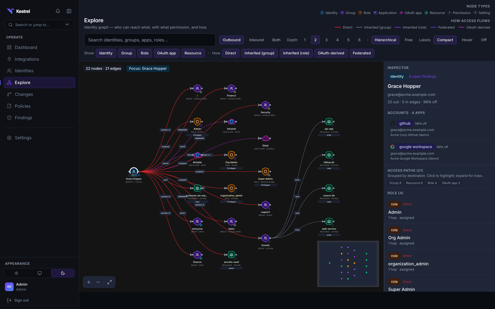
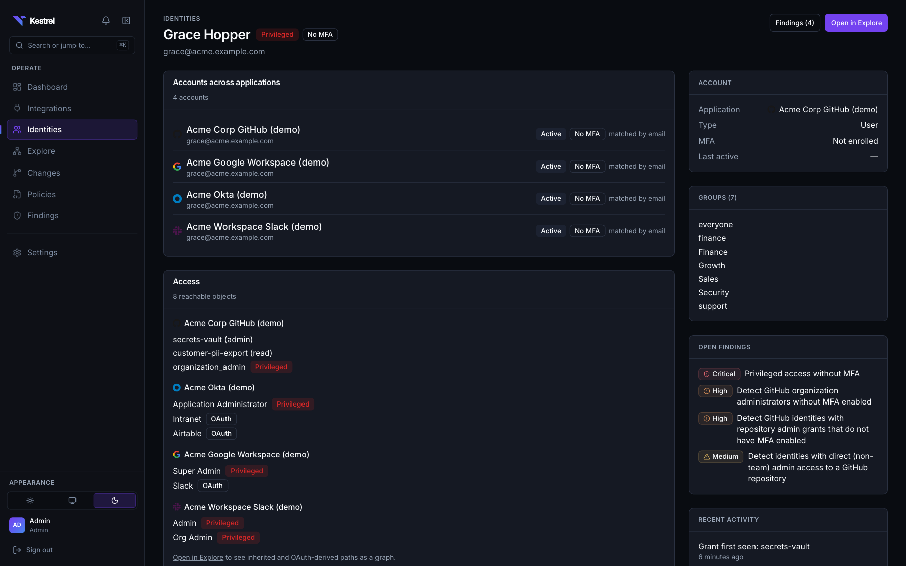
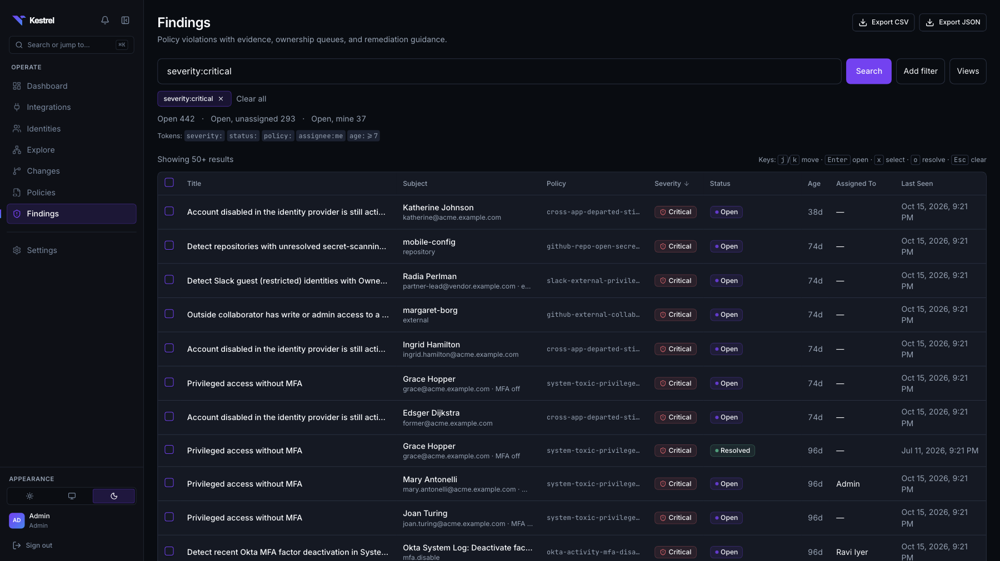
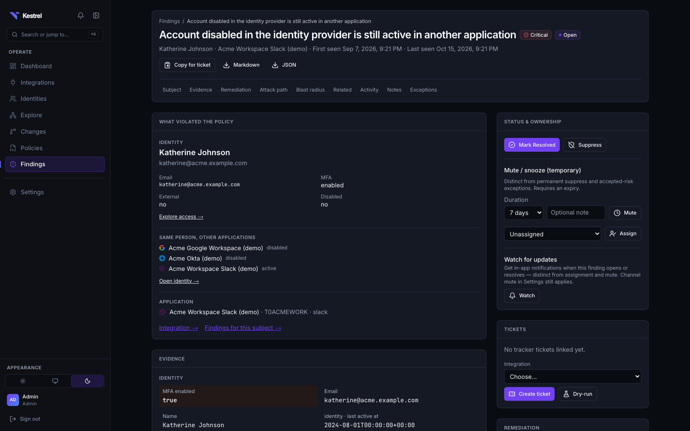
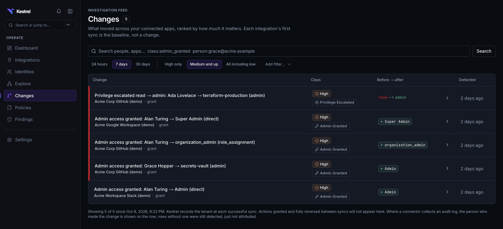
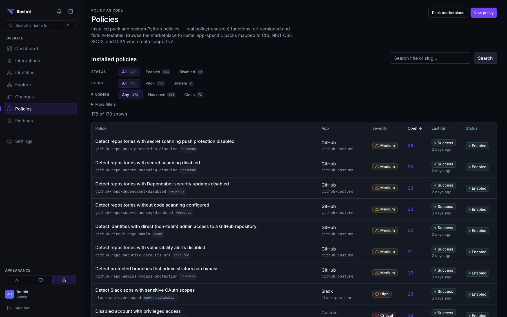
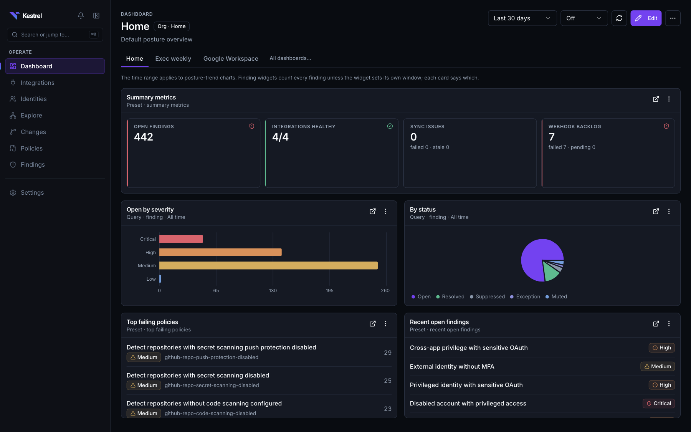
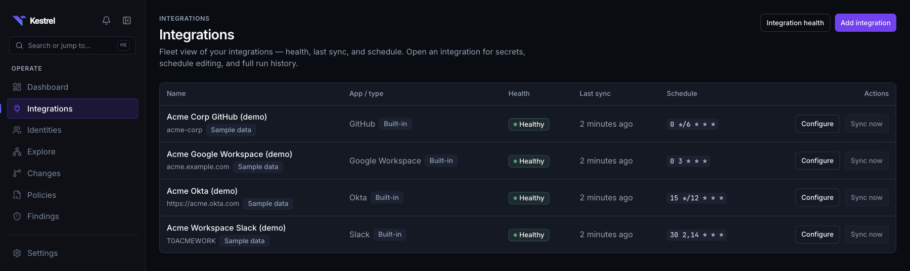
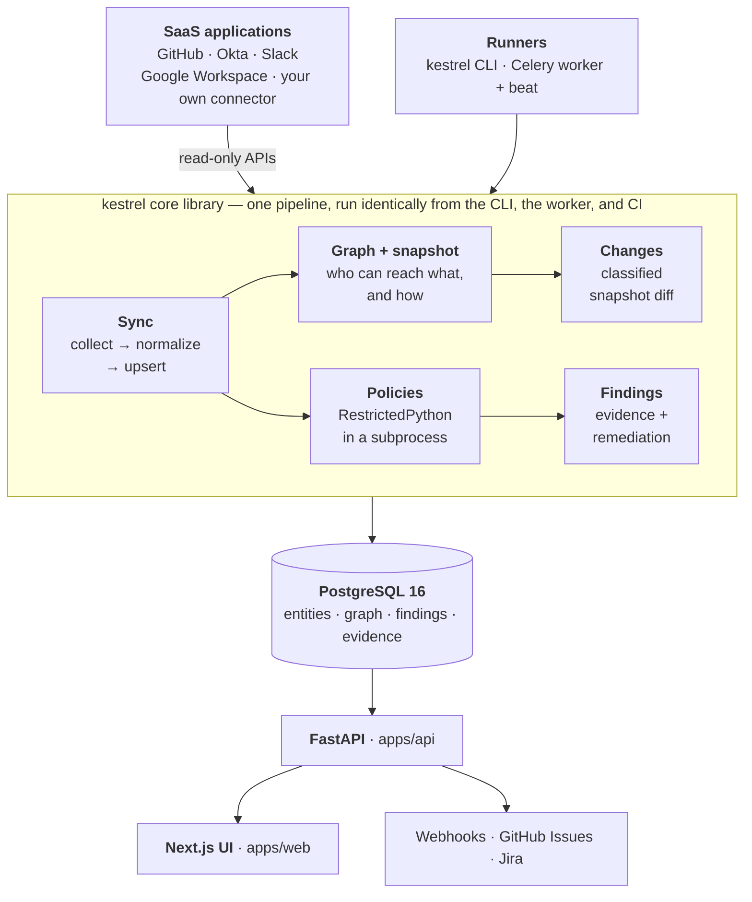

<div align="center">

<picture>
  <source media="(prefers-color-scheme: dark)" srcset="brand/assets/raster/kestrel-logo-horizontal-dark.png">
  
</picture>

### Open-source security for SaaS

**Kestrel connects to the SaaS applications you already run, normalizes their users, groups, roles, permissions, resources, settings, and OAuth grants into one identity/access graph, and tells you who can reach what — across applications, not one admin console at a time.**

It snapshots that graph on every sync, diffs the snapshots into a classified change feed, evaluates Python policies against the inventory, and produces findings with the evidence that created them and guidance to fix them. Self-hosted and Apache-2.0.

[](https://github.com/kestrel-security/kestrel/actions/workflows/ci.yaml) [](LICENSE) [](pyproject.toml) [](#project-status) [](https://docs.kestrelsecurity.io/)

[Website](https://kestrelsecurity.io) · [Documentation](https://docs.kestrelsecurity.io/) · [Quick start](#quick-start) · [Why Kestrel](#why-kestrel) · [Integrations](#integrations) · [Architecture](#architecture) · [Contributing](CONTRIBUTING.md)

</div>

<br>



<div align="center"><sub><b>Explore</b> — one person, four applications, MFA off on the focused account. Groups, privileged roles, repositories, and OAuth apps on one canvas, with every access path explained.</sub></div>

---

## Quick start

No cloud credentials required. Pick the path that matches what you want to do.

### Run it with Docker

Everything runs in containers; nothing else to install.

```bash
git clone https://github.com/kestrel-security/kestrel.git && cd kestrel
cp deployments/compose/.env.example deployments/compose/.env
# Edit deployments/compose/.env and set:
#   KESTREL_MASTER_KEY  -> openssl rand -base64 32
#   POSTGRES_PASSWORD   -> openssl rand -hex 24
#   APP_URL             -> http://localhost:3000 (the default)
#   KESTREL_HTTP_PORT   -> only if something else holds 3000; change APP_URL to match
docker compose -f deployments/compose/docker-compose.yml up -d --build
```

Kestrel doesn't publish container images. Compose builds the three images
(api, worker, web) from the Dockerfiles in [`deployments/docker/`](deployments/docker/),
on the official `python` and `node` base images; the first build takes several
minutes. Migrations run automatically before the API and worker start.

Kestrel is not on PyPI either: `pip install kestrel` installs an unrelated
project, and this project is unrelated to the Kestrel threat hunting language
(`kestrel-core` / `kestrel-lang`). Run it from Docker or from a checkout.

Create the first admin. The password is generated and printed once:

```bash
docker compose -f deployments/compose/docker-compose.yml run --rm api \
  kestrel init --admin-email you@example.com
```

Optionally load the fixture demo — four synthetic tenants and a three-month
drift timeline — so every page has data behind it:

```bash
docker compose -f deployments/compose/docker-compose.yml run --rm api kestrel demo up
docker compose -f deployments/compose/docker-compose.yml run --rm api kestrel demo change
```

Open **http://localhost:3000/login**. To put it on a network, behind TLS, see
[`docs/deployment.md`](docs/deployment.md).

### Develop on it

`make demo-up` builds the same four synthetic tenants against a development
stack with live reload.

```bash
git clone https://github.com/kestrel-security/kestrel.git && cd kestrel
make sync        # uv sync && pnpm install
make demo-up     # Postgres + Redis, migrations, admin, four fixture tenants, drift timeline, API, worker, web
```

Open **http://localhost:3010** and sign in with `admin@kestrel.local` / `kestrel-dev-password` (local development defaults — never use them on a reachable network). The Docker path above serves on `3000`; the development stack shifts its host ports so it can run next to a host `next dev` server or the Docker deployment.

| Prerequisite | Docker path | Developer path |
|---|---|---|
| Docker with Compose v2 | Required | Required (PostgreSQL 16, Redis 7, and the app containers) |
| Python 3.12+ with [`uv`](https://docs.astral.sh/uv/) | — | Required |
| Node.js 22+ with `pnpm` 10 (`corepack enable`, or [install pnpm directly](https://pnpm.io/installation) on a Node build without corepack) | — | Required |
| `make` | — | Required |

Allow about 4 GB of free memory for the build and the running stack. On the
developer path, host ports are shifted to avoid collisions: web `3010`, API
`8010`, Postgres `5433`, Redis `6380`. `make demo-down` tears it down.
Migrations, the `.env` file, and the admin operator are created for you; the
individual steps are in [`docs/getting-started.md`](docs/getting-started.md).
The development stack's Compose project is always named `kestrel`, so every
checkout on a machine shares one set of containers and one database, and
`make demo-down` or `docker compose down -v` acts on whichever is running. Set
`COMPOSE_PROJECT_NAME` before `make demo-up` to give a second checkout its own.

**Then connect a real tenant:** Integrations → Add integration walks you through minting read-only credentials for GitHub, Okta, Slack, or Google Workspace without leaving the product. Setup guides: [`docs/connectors/`](docs/connectors/).

### Clean up or start over

```bash
# Docker path
docker compose -f deployments/compose/docker-compose.yml run --rm api kestrel demo down --yes   # remove the demo tenants
docker compose -f deployments/compose/docker-compose.yml down      # stop the stack; data is kept
docker compose -f deployments/compose/docker-compose.yml down -v   # stop and delete all data (database, queue, certificates)

# Developer path
make demo-down          # remove the demo tenants, then stop the containers
docker compose down -v  # also delete the development database
```

`kestrel demo down` removes only the demo tenants and everything derived from them; the organization, operators, policies, and installed packs stay. That is the way from the demo to a real deployment: drop the demo tenants, then add an integration for each application using its [setup guide](docs/connectors/).

---

## Why Kestrel

SaaS access is fragmented by construction. A person's effective privilege is assembled from an identity provider account, group memberships that grant roles indirectly, direct grants that bypass groups entirely, guest and external accounts in individual workspaces, and OAuth applications holding delegated scopes on their behalf. Every one of those lives in a different admin console, and none of those consoles can see the others.

The questions that matter are the cross-application ones:

- **Who actually has admin, everywhere?** Privilege concentrated on one person across applications is a blast radius nobody sized on purpose.
- **What survived offboarding?** An account the identity provider disabled is still live in Slack, GitHub, or Google Workspace more often than anyone expects.
- **Which accounts does no identity provider know about?** Local accounts, guests, and service accounts that never appear in the IdP.
- **What can a third-party OAuth app reach?** Delegated scopes are access, granted by users, reviewed by nobody.
- **What changed since last week?** Privilege escalation, new admins, MFA turned off, external sharing enabled, app installs.
- **And what is the evidence?** Every claim above has to be traceable to a provider payload, or it is an opinion.

Kestrel answers these from one normalized graph, and it does it in infrastructure you control. Four design choices make it different from a closed SSPM:

| | |
|---|---|
| **Connectors are ordinary Python packages** | `kestrel connector create <name>` scaffolds a working, fixture-testable connector built on `kestrel.connectors.sdk`. Onboarding an internal or unsupported app never waits on a vendor roadmap and never requires a core change. |
| **Policies are code, not a rule builder** | A policy is a module with `policy(resource) -> bool` — `True` is compliant, `False` opens a finding — compiled with RestrictedPython and evaluated in an isolated subprocess. It is diffable, code-reviewable, fixture-tested, and versioned in git. |
| **Provenance on every row** | Every normalized entity keeps its raw provider payload as `raw_source` next to the normalized columns, so a finding can always show what it was derived from. |
| **A real graph, in PostgreSQL** | `graph_nodes` / `graph_edges` distinguish direct, inherited (group), inherited (role), federated, and OAuth-derived access, traversed with recursive CTEs. No graph database to operate. |

---

## Key capabilities

### Unified identity across applications

Accounts are correlated into one person by email, materialized in `identity_links`, and drawn as federated edges in the graph. The identity page shows every account, its MFA and activity state, and everything it can reach in each application.



### Access intelligence

The Explore canvas answers "who can reach what, with what permission, and how" — filtered by node type and by how the access flows, with an inspector that lists every access path grouped by destination and hop count.

### Findings with evidence and remediation



Search-first triage (`severity:critical status:open assignee:me age:>=7`), keyboard-driven, with CSV and JSON export. Each finding carries the subject that violated the policy, the evidence, remediation guidance, an attack path, blast radius, related findings, notes, watchers, exceptions, and playbooks. Findings open and auto-resolve against live matches, fan out to HMAC-signed webhooks, and can be pushed to GitHub Issues or Jira Cloud. Toxic combinations — open findings that together form a worse risk on the same subject — are raised as their own findings, linked to the findings that compose them. Each operator gets an in-app notification inbox, optional email, and a weekly digest of the findings they watch.



### Change detection



Every sync writes a hashed snapshot. Snapshots are diffed into a classified feed — admin granted, privilege escalated, OAuth app installed, external sharing enabled, MFA disabled, configuration drift — with before/after values and, where the connector collects an audit log, the person who made the change. Each connector's first sync is the baseline, not a change.

### Policies as code



**More than 150 policies across the first-party packs in [`packs/`](packs/)**, mapped to CIS, NIST CSF 1.1, SOC 2, and CISA SCuBA-style controls where the collected data actually supports the claim. Author your own in the workbench with fixture tests and dry run, install packs from the marketplace, or manage everything as code with `kestrel export` / `plan` / `apply`. AI-assisted drafts are available with your own LLM credentials and never auto-enable a policy.


### Posture overview



Configurable multi-board dashboards over findings and connectors, a daily posture-trend widget, a constrained metric DSL, PDF export, and scheduled email.

### Self-hosted and operator-ready

Local email/password login with opaque session and API tokens, three fixed roles, Argon2id hashing, login lockout, request rate limiting, and an audit log. Connector secrets are envelope-encrypted with AES-256-GCM. Every live connector URL passes an SSRF guard. Connectors declare read-only scopes and the loader **refuses** write scopes.

---

## Integrations

Four first-party connectors plus a worked custom-connector example. Every connector ships a fixture mode — the CI-verified, offline path — and a live mode.



Connector instances carry envelope-encrypted secrets, a test-connection check that runs before anything is saved, manual and `schedule_cron` syncs, full run history, and a health view that reports reduced coverage rather than hiding it.

| Application | Status | Auth | What it collects |
|---|---|---|---|
| **GitHub** | Supported | GitHub App (recommended), classic or fine-grained PAT | Org membership, teams, repository access, outside collaborators, Actions permissions and runners, secrets/variables metadata, webhooks, installed Apps and their permission sets, rulesets, SSO-authorized credentials, custom roles, invitations, per-repo posture, Copilot and package settings, secret-scanning / Dependabot / code-scanning alert counts, audit log |
| **Okta** | Supported | OAuth 2.0 service app (recommended) or SSWS API token | Users, groups, admin roles, apps and assignments, password / MFA-enrollment / authentication / sign-on / profile-enrollment / IdP-routing policies, authenticators, device assurance, network zones, trusted origins, hooks, identity providers, group rules, Threat Insight and behavior settings, log streams, authorization servers, System Log |
| **Slack** | Supported | User OAuth token | Members, user groups, workspace and org roles, installed apps and scopes, app requests, Slack Connect external teams, channels and shared channels, anomaly allowlist, per-account session settings, SSO policy, information barriers, workflows, channel retention, invite requests; Enterprise Grid Admin and Audit Logs APIs where available |
| **Google Workspace** | Supported | Service-account JWT (domain-wide delegation) | Domains, org units, users, groups and settings, admin roles and assignments, shared drives and permissions, user OAuth tokens, Cloud Identity policies, mobile and ChromeOS devices, alerts, inbound SSO profiles, domain-wide delegation clients, admin / login / Drive / SAML activity |

The full object-type list for each connector is its `connectors/<name>/manifest.yaml`. Live collection depth differs per connector, and every plan- or permission-gated family degrades visibly rather than failing the run or reading as revoked access. Live-tenant smoke sign-off is still open across the first-party connectors — the checklist and per-connector state are in [`docs/connectors.md`](docs/connectors.md). Each connector README states what it collects and what it does not. The exact scopes and roles each one needs, and what degrades without the optional ones, are in [Permissions at a glance](docs/connectors.md#permissions-at-a-glance).

**Not on the list?** [Build it.](#extending-kestrel) That is the point.

---

## What Kestrel finds

A sample of shipped policies, all written in Python you can read, test, and change:

**Cross-application** — only visible when two applications are read together
- Account disabled in the identity provider that is still active in another application
- A company account no identity provider knows about
- Privileged roles concentrated on one person across multiple SaaS applications

**Identity and privilege**
- Okta Super / Org / App / Help Desk / Group admins without MFA · dormant admins · disabled accounts still holding privileged roles
- Google Workspace Super Admins without MFA · external or disabled super admins · domain 2SV not enforced
- Slack privileged roles without MFA · guests in private channels · dormant admins · sessions that outlast a working day
- GitHub org admins without MFA · external collaborators with admin · direct (non-team) repository admin · pending admin invitations

**OAuth and third-party apps**
- Slack apps with sensitive OAuth scopes, over-scoped apps, unused apps, pending app requests
- Google Workspace third-party apps with sensitive scopes · personal consent to risky apps

**Configuration and supply chain**
- GitHub: default branch unprotected, force push allowed, no required reviews, admins bypass protection, secret scanning and push protection disabled, Dependabot disabled, unresolved secret-scanning alerts, default `GITHUB_TOKEN` write scope, all third-party Actions allowed, runner groups reachable from public repos, org secrets visible to all repos, webhooks without TLS verification, rulesets that evaluate without enforcing
- Okta: weak password policy, session never expires, no phishing-resistant authenticator, network zone matching everything, hooks over plain HTTP, self-service registration enabled, Threat Insight disabled
- Slack / Google Workspace: external sharing permissive, externally shared channels unrestricted, groups allowing external members

**Activity policies** over provider audit logs — privilege grants, branch-protection removal, repositories made public, SSO changes, App installs, deploy keys, MFA disabled, Okta threat detections, suspicious logins.

Full catalog and compliance mappings: [`packs/`](packs/) and [`docs/policies.md`](docs/policies.md).

---

## Architecture



| Component | What it is |
|---|---|
| `kestrel/` | The core library: data model, Connector SDK, sync pipeline, graph writer and queries, change classification, policy runtime, findings, secrets, CLI. Framework-agnostic — it depends on neither app. |
| `apps/api/` | FastAPI service. The REST API under `/api/v1/*`, plus `/healthz`, `/readyz`, `/metrics`, and OpenAPI at `/docs`. |
| `apps/worker/` | Celery worker and beat scheduler: syncs, scheduled syncs (`schedule_cron`), policy evaluation, webhook delivery, dashboard schedules. |
| `apps/web/` | Next.js 16 App Router UI — Dashboard · Integrations · Identities · Explore · Changes · Policies · Findings (+ Settings). |
| `connectors/` `packs/` | First-party connector packages and policy packs. Both are extension points, not core. |

**The sync pipeline**, identical whether it runs from the CLI, the worker, or CI: authenticate → discover collectable object types → collect raw objects → normalize (pure, I/O-free) → upsert entities and relationships, diffing every change into `events` → write the graph and a hashed snapshot → classify changes against the previous run → evaluate enabled policies → reconcile findings → deliver webhooks.

`kestrel sync --no-async` runs that exact pipeline in-process, without Celery or Redis. Deletion is a tombstone, never a delete: a row the provider stopped reporting keeps its provenance and evidence.

Deeper: [`docs/architecture.md`](docs/architecture.md), [`docs/domain-model.md`](docs/domain-model.md), and the ADRs under [`docs/adr/`](docs/adr/).

---

## A worked example

1. **Connect** Okta, GitHub, Slack, and Google Workspace with read-only credentials. Kestrel validates the scopes and refuses write scopes.
2. **Sync.** Each connector collects its object types, normalizes them into shared entities, and keeps every raw payload as provenance.
3. **Correlate.** Accounts sharing an email collapse into one person; the graph gains federated edges between their accounts in each application.
4. **Detect.** `cross-app-departed-still-has-access` opens a **critical** finding: a person Okta and Google Workspace disabled, and GitHub removed, is still active in Slack.
5. **Investigate.** The finding shows the subject, the same person's status in every other application, the evidence rows it was derived from, the attack path, and the blast radius. **Open identity →** pivots to their profile, and **Explore access →** expands the full access graph — the groups, roles, and apps that account still reaches.
6. **Act.** Follow the playbook, file a Jira ticket or GitHub issue from the finding, or accept the risk as a tracked exception. On the next sync the finding auto-resolves when the access is actually gone — and **Changes** records the revocation with before/after values.

`make demo-up` (or `kestrel demo up` in the Docker deployment) reproduces this whole path locally. The first run builds three container images, which takes several minutes; loading the demo and replaying the drift timeline takes a few minutes more. The walkthrough script is in [`docs/demo.md`](docs/demo.md).

---

## Extending Kestrel

**Build a connector** — a Python package, no core changes:

```bash
uv run kestrel connector create my-app       # scaffold with fixtures and tests
uv run kestrel connector validate connectors/my-app   # manifest, load, collect → normalize, coverage contract
```

The SDK is four `typing.Protocol`s — `Transport`, `Collector`, `Normalizer`, and the `Connector` that ties them together — plus a per-connector `build_live_transport()` that turns config and secrets into a `Transport`, and a `manifest.yaml` declaring auth methods, read-only scopes, object types and the entities they map to, and the change classes the connector guarantees. Fixture mode replays JSON by request signature and never touches the network, so a connector is testable in CI with no tenant. Start with [`docs/connectors/authoring-tutorial.md`](docs/connectors/authoring-tutorial.md) and [`examples/custom-connector/`](examples/custom-connector/).

**Write a policy** — a Python function, versioned in git:

```python
# Abridged from packs/slack-posture/policies/slack_privileged_without_mfa.py
POLICY_ID = "slack-privileged-without-mfa"
TITLE = "Detect Slack Primary Owners, Owners, or Admins without two-factor authentication"
SEVERITY = "high"
RESOURCE_TYPE = "identity"
REMEDIATION = "Require 2FA for the privileged Slack account, or demote the user from Admin/Owner."
COMPLIANCE = {"soc2": ["CC6.1", "CC6.2"], "cis": ["6.3"], "nist_csf": ["PR.AC-7"]}


def policy(resource) -> bool:
    """True = compliant. False opens a finding."""
    application = resource.get("application") or {}
    identity = resource.get("identity") or {}
    roles = resource.get("roles") or []
    if application.get("type") != "slack":
        return True
    if not any(r in roles for r in ("Admin", "Owner", "Primary Owner")):
        return True
    return bool(identity.get("mfa_enabled"))
```

```bash
uv run kestrel policy validate examples/policies/my_first_policy.py
uv run kestrel policy test examples/policies/my_first_policy.py \
  --fixtures examples/policies/my-first-policy.fixtures.json
uv run kestrel pack install packs/github-posture
```

**Manage it as code** — `kestrel export`, `plan`, and `apply` round-trip packs, custom policies, connector instances, and exceptions through a desired-state manifest; `plan` exits non-zero on drift, so it works as a CI gate. See [`docs/gitops.md`](docs/gitops.md) and [`docs/policies.md`](docs/policies.md).

---

## Deployment

Kestrel is **self-hosted**. It aggregates sensitive posture data, so deploy it behind a network boundary you trust and read [`SECURITY.md`](SECURITY.md) and [`docs/threat-model.md`](docs/threat-model.md) first.

| Path | State | Notes |
|---|---|---|
| **Docker Compose** | Supported (single node) | `deployments/compose/docker-compose.yml` builds the images from `deployments/docker/`, runs migrations before the API and worker start, publishes only the web UI (on loopback by default), and has an optional `tls` profile that puts Caddy in front. The root `docker-compose.yml` is the development stack. |
| **Other platforms** | Bring your own | Build the images from `deployments/docker/` and push them to your own registry; see [Building the images](docs/deployment.md#building-the-images). No Kubernetes manifests or Helm chart are provided. |
| **Local development** | Supported | Compose plus fixtures; see [Development](#development). |

Configuration for the Compose deployment lives in [`deployments/compose/.env.example`](deployments/compose/.env.example) (copy it to `deployments/compose/.env`; that is the only file a Docker deployment edits). Every application variable is documented in the development [`.env.example`](.env.example) at the repository root:

| Variable | Required | Purpose |
|---|---|---|
| `KESTREL_MASTER_KEY` | Yes | Base64 32-byte root key for stored-secret encryption. `openssl rand -base64 32`. **Back it up separately from the database** — a database dump cannot be decrypted without it. Rotate it with `kestrel secrets rotate` ([`docs/deployment.md`](docs/deployment.md)). |
| `POSTGRES_PASSWORD` | Yes | Password for the bundled PostgreSQL; the Compose file builds `DATABASE_URL` from it |
| `APP_URL` | Yes | The origin browsers use, scheme included (`https://kestrel.example.com`). The `/login` redirect and the API's allowed origin are built from it, and the session cookie is marked `Secure` when it is `https` |
| `KESTREL_BIND_ADDRESS` | No | Host address the web UI listens on (default `127.0.0.1`) |
| `KESTREL_HTTP_PORT` | No | Host port for the web UI (default `3000`) |
| `KESTREL_COOKIE_SECURE` | No | Force the session cookie's `Secure` flag (`true` / `false`) instead of deriving it from `APP_URL` |

`DATABASE_URL`, `REDIS_URL`, and `API_URL` are derived inside the Compose file
and are not settable from that `.env`; when you run the images on your own
platform, supply them yourself ([Building the images](docs/deployment.md#building-the-images)).

Upgrades apply Alembic migrations before starting the new API and worker; the Compose deployment does this itself with a one-shot `migrate` service. Backups, observability, retention, and rate-limit tuning: [`docs/deployment.md`](docs/deployment.md), [`docs/observability.md`](docs/observability.md), [`docs/operations/`](docs/operations/).

---

## Development

```bash
make sync        # uv sync + pnpm install
docker compose up -d postgres redis
make seed        # kestrel init --seed — one fixture-backed GitHub tenant, seconds
make dev         # docker compose up --build

# or run the services on the host with live reload:
export KESTREL_MASTER_KEY="$(grep '^KESTREL_MASTER_KEY=' .env | cut -d= -f2-)"   # host processes do not read .env
uv run uvicorn kestrel_api.main:app --reload --port 8010
uv run celery -A kestrel_worker.celery_app worker --beat -l info
API_URL=http://localhost:8010/api/v1 pnpm --filter kestrel-web dev   # http://localhost:3000
```

Tests run in three tiers — unit (no database), integration (PostgreSQL), and system (CLI end-to-end):

```bash
uv run pytest -m unit -q                          # Tier 1, no database
uv run pytest -m "unit or integration" -n auto    # the PR gate; needs Postgres on localhost:5433
uv run pytest -n auto                             # everything, including Tier 3
make lint                                         # ruff check + ruff format --check + mypy
make validate                                     # the full local gate, same as CI
make hygiene                                      # secret scan + public-repo denylist
uv run alembic revision --autogenerate -m "..."   # migrations
```

Test tiers, the harness contract, and the fixture rules are in [`docs/testing.md`](docs/testing.md).

---

## Project status

**Pre-1.0 and under active development.** Releases are tagged from `main`; see [`CHANGELOG.md`](CHANGELOG.md), whose entries up to 0.5.1 predate this public repository.

The core is real and exercised end to end: the collect → normalize → upsert → graph → snapshot → classified changes → policy → finding pipeline runs the same code path from the CLI, the worker, and CI, behind a tiered test suite with blocking dependency, secret, and container scans. Four connectors, more than 150 policies, and the full product surface work today. What that means practically: **evaluate it, run it against a real tenant with read-only credentials, and expect APIs and schemas to move before 1.0.**

Known gaps, documented in [`docs/roadmap.md`](docs/roadmap.md) and [`docs/threat-model.md`](docs/threat-model.md):

- No automated remediation write-back. Guided playbooks and ticketing ship; connectors stay read-only by design.
- Secrets use a single root key rather than a KMS-backed key provider.
- Tenant isolation is enforced in application code and covered by regression tests; there is no PostgreSQL row-level security backstop yet.
- Connectors are trusted Python with no sandbox. Policies are isolated (RestrictedPython + subprocess), but that is not a full sandbox either.
- No signed releases, no published images, and no high-availability deployment. Incremental cursors cover provider audit logs; inventory is re-read in full on every sync.

These are stated plainly in [`docs/threat-model.md`](docs/threat-model.md) rather than buried.

## Roadmap

Themes rather than promises — capability status is in [`docs/roadmap.md`](docs/roadmap.md); new bugs and feature requests go in [GitHub issues](https://github.com/kestrel-security/kestrel/issues).

- Deeper live collection per connector, and live-tenant smoke sign-off across the first-party set
- More cross-application policies and richer entitlement analysis
- Remediation write-back behind explicit approval gates
- KMS-backed secrets, PostgreSQL row-level security, and signed releases
- SSO/SCIM and hardened Kubernetes deployment

---

## Contributing

Contributions are welcome, and connectors and policy packs are the easiest place to start — both are extension points that need no core changes.

- **Bugs and features:** open an issue with the templates. Issues labelled [`good first issue`](https://github.com/kestrel-security/kestrel/labels/good%20first%20issue), when there are any, are scoped for newcomers; [`docs/roadmap.md`](docs/roadmap.md) lists open work too.
- **A new connector:** [`docs/connectors/authoring-tutorial.md`](docs/connectors/authoring-tutorial.md) builds one end to end. The quality bar a first-party connector is held to is written down in [`docs/connectors.md`](docs/connectors.md).
- **A new policy:** [`docs/policies.md`](docs/policies.md). Policies need fixtures; packs need compliance mappings that the collected data actually supports.
- **Anything architectural:** open an issue first. Significant decisions get an ADR under [`docs/adr/`](docs/adr/).

[`CONTRIBUTING.md`](CONTRIBUTING.md) has setup, conventions, the test tiers, and the Developer Certificate of Origin sign-off (`git commit -s`). Run `make validate` and `make hygiene` before opening a pull request. This project follows the [Contributor Covenant](CODE_OF_CONDUCT.md).

## Security

**Do not open a public issue for a vulnerability.** Use [GitHub private vulnerability reporting](https://github.com/kestrel-security/kestrel/security/advisories/new). We aim to acknowledge within 5 business days and to have a remediation plan within 30 days for confirmed issues, and we credit reporters in release notes unless anonymity is requested.

### How credentials and tokens are handled

- **Connector credentials are read-only and encrypted at rest.** Each connector's manifest declares the read-only scopes it needs, and the loader refuses write scopes. Tokens and client secrets are stored as AES-256-GCM ciphertext under a per-organization key derived from `KESTREL_MASTER_KEY`, bound to the row and field they belong to ([ADR-0004](docs/adr/0004-secrets-storage-and-encryption.md)).
- **Secrets never leave through the side doors.** Fields a manifest marks as secret are redacted before anything is logged, returned by the API, or sent to an AI provider.
- **Operator sessions and API tokens are opaque.** They are random, stored only as SHA-256 hashes, and revocable; browser sessions slide but have a fixed 30-day ceiling ([ADR-0008](docs/adr/0008-opaque-tokens-for-operator-auth.md)).
- **You own the root key.** Back up `KESTREL_MASTER_KEY` separately from the database and rotate it with `kestrel secrets rotate`. Without it, stored secrets cannot be recovered. It reduces the exposure of a stolen database dump; it is not a substitute for a dedicated secrets manager.
- **Nothing is sent home.** Kestrel is self-hosted and talks only to the SaaS APIs you connect and the integrations you configure.

Full policy, scope, and known limitations: [`SECURITY.md`](SECURITY.md). Assets, trust boundaries, and what Kestrel does and does not defend against: [`docs/threat-model.md`](docs/threat-model.md).

---

## Documentation

The documentation for the latest release is at **[docs.kestrelsecurity.io](https://docs.kestrelsecurity.io/)**; the same pages are under [`docs/`](docs/).

| Document | Purpose |
|---|---|
| [docs/README.md](docs/README.md) | Index of every page under `docs/` |
| [docs/faq.md](docs/faq.md) | Telemetry, permissions, where data lives, platforms, production readiness |
| [docs/getting-started.md](docs/getting-started.md) | Docker and local setup, ports, configuration, operators and tokens, troubleshooting |
| [docs/architecture.md](docs/architecture.md) | Components, sync pipeline, data model, extension model |
| [docs/connectors.md](docs/connectors.md) | SDK contract, connector lifecycle, first-party state, quality bar |
| [docs/policies.md](docs/policies.md) | Policy contract, runtime, packs, workbench, AI drafts |
| [docs/identity-graph.md](docs/identity-graph.md) · [docs/changes.md](docs/changes.md) · [docs/findings.md](docs/findings.md) | The graph, the change feed, and the finding lifecycle |
| [docs/dashboards.md](docs/dashboards.md) · [docs/ticketing.md](docs/ticketing.md) | Boards and the metric DSL, export and schedules; GitHub Issues and Jira Cloud tickets |
| [docs/posture-baselines/](docs/posture-baselines/README.md) | Per-application control matrices: what each baseline control needs, what is collected, which policy implements it |
| [GitHub](docs/connectors/github-setup.md) · [Google Workspace](docs/connectors/google-workspace-setup.md) · [Okta](docs/connectors/okta-setup.md) · [Slack](docs/connectors/slack-setup.md) setup | Credentials and permissions for each first-party connector |
| [docs/api.md](docs/api.md) | Authentication, errors, pagination, rate limits, webhooks, route tables |
| [docs/deployment.md](docs/deployment.md) · [docs/observability.md](docs/observability.md) | Compose, building the images, upgrades, backups, metrics and tracing |
| [Scheduled syncs](docs/operations/scheduled-syncs.md) · [rate limiting](docs/operations/rate-limiting.md) · [data retention](docs/operations/data-retention.md) | Running Kestrel day to day |
| [docs/testing.md](docs/testing.md) | Test tiers, harness, commands |
| [docs/threat-model.md](docs/threat-model.md) · [SECURITY.md](SECURITY.md) | Threat model and security policy |
| [docs/product.md](docs/product.md) · [docs/roadmap.md](docs/roadmap.md) · [docs/decisions.md](docs/decisions.md) | Product definition, capability status, decision log |
| [CONTRIBUTING.md](CONTRIBUTING.md) · [CHANGELOG.md](CHANGELOG.md) | How to contribute, notable changes |

---

## About

Kestrel is an open-source project maintained by its contributors; see [`MAINTAINERS.md`](MAINTAINERS.md) and [`GOVERNANCE.md`](GOVERNANCE.md). Contributions and new maintainers are welcome. Website: [kestrelsecurity.io](https://kestrelsecurity.io) · Documentation: [docs.kestrelsecurity.io](https://docs.kestrelsecurity.io/).

## License

[Apache License 2.0](LICENSE). See [`NOTICE`](NOTICE) for attribution and third-party marks.

Every connector and policy in this repository is open source under the same license.

<div align="center"><sub>Product names and logos shown in Explore and finding investigation identify third-party products and remain the trademarks of their respective owners.</sub></div>
