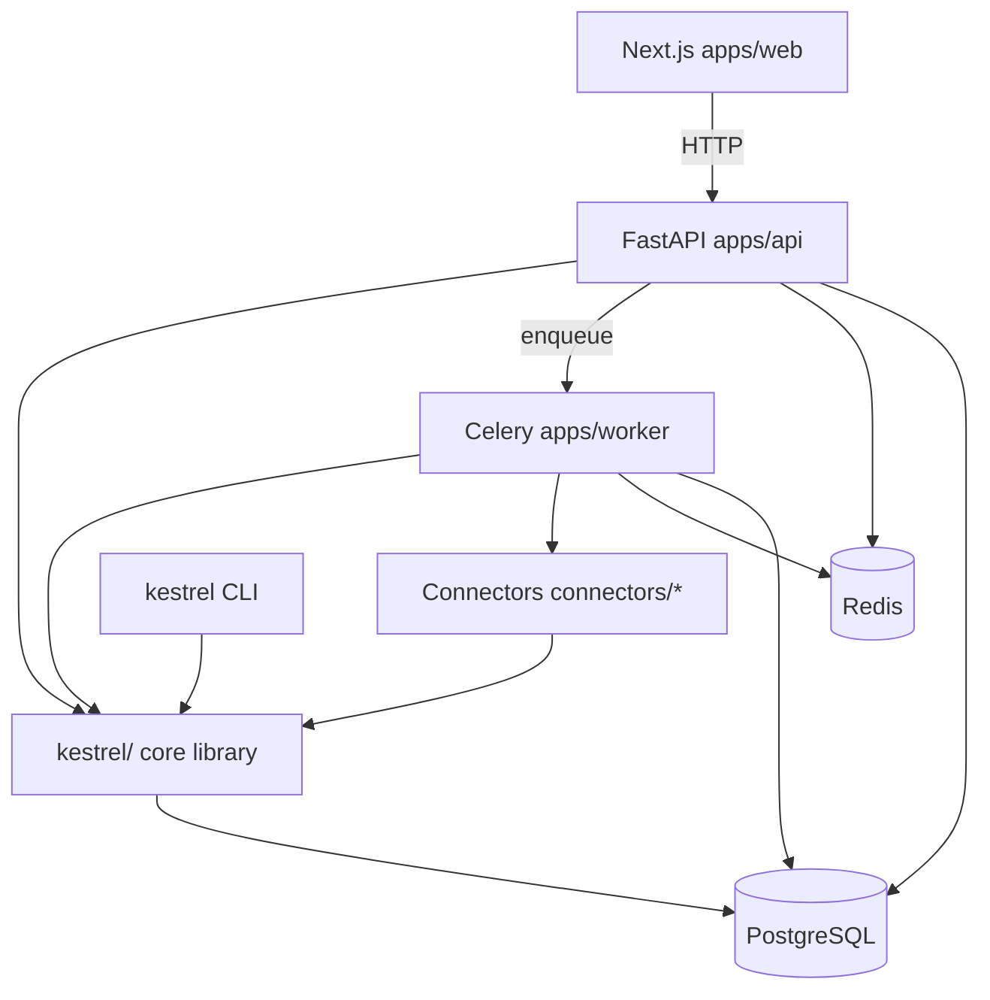
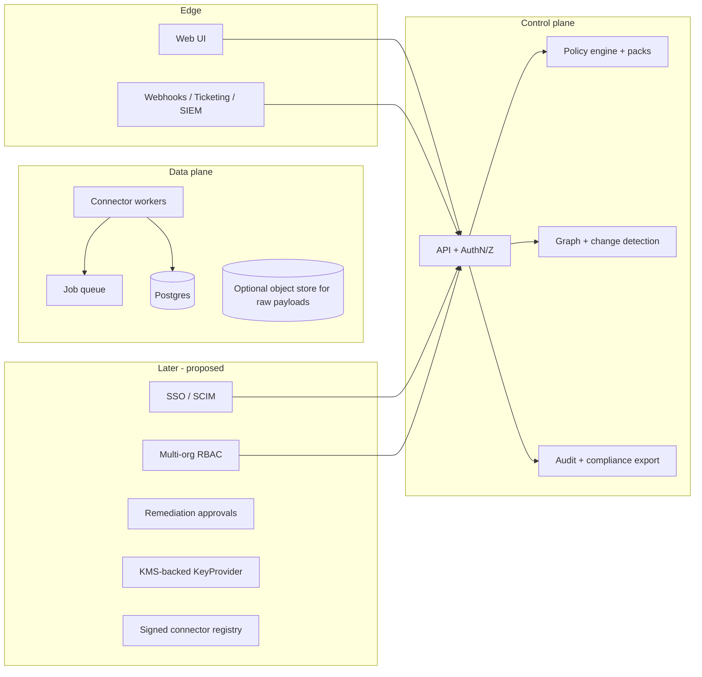

# Architecture

What exists in the repository today, how the pieces fit, and a clearly labeled
proposed target. Decisions and their reasoning are in
[`decisions.md`](decisions.md) and [`adr/`](adr/); the threat model is
[`threat-model.md`](threat-model.md); the data model is
[`domain-model.md`](domain-model.md).

## Principles

- Tenant isolation: `org_id` on every tenant-owned row, enforced in application code
- Least privilege: connectors declare read-only scopes and the loader refuses write scopes
- Idempotent synchronization: upsert by provider object id; a re-sync is a no-op; one sync per connector instance at a time (Redis lock plus a `connector_runs` guard)
- Deletion is a tombstone, never a delete: a row the provider stopped reporting keeps its provenance and evidence, carries `deleted_at`, and disappears from every "what exists now" read path
- Reconciliation: findings open and auto-resolve against live matches
- Explicit, versioned schemas: SQLAlchemy models + Alembic; `schema_version` on entities; manifest versions on connectors; `PolicyVersion` rows
- Provenance everywhere: every normalized row keeps its provider payload as `raw_source`
- Safe retries and bounded work: Celery retries; graph traversal depth caps; policy evaluation in batches
- Eventual consistency where appropriate: the graph is a derived read model
- Reproducible local development: Compose plus fixtures; no cloud credentials needed to see findings
- Secure defaults: secrets encrypted at rest, never logged; auth required on every API route
- No dependence on AI for deterministic security decisions

## Components



`kestrel` (the core library) has no dependency on `apps/api` or `apps/worker`;
both depend on it. `kestrel sync --no-async` runs the identical pipeline the
worker uses, in-process, without Celery or Redis.

| Area | Status | Notes |
|------|--------|-------|
| Frontend | Implemented | Next.js 16 App Router, Server Components and Server Actions; Dashboard · Integrations · Identities · Explore · Changes · Policies · Findings (+ Settings) |
| API | Implemented | FastAPI, `/api/v1/*`; routers for auth, operators, API tokens, dashboard(s), changes, graph, identities, search, findings, connectors, policies, packs, audit, webhooks, ticket integrations, AI settings, notification preferences, notifications; OpenAPI at `/docs` |
| Authentication | Implemented | Opaque bearer tokens backing browser sessions (`OperatorSession`) and long-lived `ApiToken`s; local email/password login; Argon2id; lockout ([ADR-0008](adr/0008-opaque-tokens-for-operator-auth.md)) |
| Authorization | Implemented | Org scoping in every query; three fixed roles (`read_only` < `analyst` < `admin`) via `require_role` |
| Database | Implemented | PostgreSQL 16; Alembic initial schema plus additive migrations |
| Queue | Implemented | Celery + Redis; beat dispatches `schedule_cron` syncs and dashboard schedules; webhook delivery tasks ([ADR-0007](adr/0007-job-worker-framework.md)) |
| Connector runtime | Implemented | Protocol-based SDK, fixture and live transports, runner; four first-party connectors (GitHub, Google Workspace, Okta, Slack) plus a worked custom-connector example under `examples/custom-connector` ([ADR-0005](adr/0005-connector-sdk-interface-design.md)) |
| Change detection | Implemented | Entity-diff `events` on every sync; hashed graph snapshots per run; classified change feed (DEC-024) |
| Policy engine | Implemented | Python `PolicyRuntime`: RestrictedPython compile, subprocess isolation by default; event and application resource types; packs; AI drafts that an operator must validate, test, and enable ([ADR-0009](adr/0009-python-policies.md)) |
| Identity graph | Implemented | `graph_nodes` / `graph_edges` in PostgreSQL, recursive-CTE traversal, cross-connector identity correlation materialized in `identity_links` and drawn as `maps_to` / federated edges, Explore canvas and Identities pages ([ADR-0003](adr/0003-graph-representation-in-postgres.md)) |
| Findings | Implemented | Reconciliation pipeline, evidence, provenance, notes, watchers, exceptions, playbooks, verify, handoff, tickets |
| Dashboards | Implemented | Multi-board, constrained metric DSL, PDF export, scheduled email via the org's mail server (DEC-023, DEC-029) |
| Webhooks | Implemented | Outbound HMAC-signed finding webhooks; delivery history and retry |
| Secrets | Implemented | AES-256-GCM envelope encryption keyed from `KESTREL_MASTER_KEY`; single root key ([ADR-0004](adr/0004-secrets-storage-and-encryption.md)) |
| Observability | Implemented | Structured request logs; Prometheus `/metrics` and worker scrape port; optional OTLP tracing |
| Rate limiting | Implemented | Fixed-window middleware, Redis or in-memory, with auth-aware, expensive, and login tiers |
| Deployment | Partial | Dockerfiles and Compose for the full stack; no published images; no HA hardening |
| Multi-tenancy | Partial | Schema carries `org_id` everywhere; single-org UX; no Postgres RLS ([ADR-0006](adr/0006-multi-tenancy-approach.md)) |
| Testing | Implemented | Unit, integration, and system tiers with per-worker databases ([`testing.md`](testing.md)) |

## Sync pipeline

Every connector, built-in or scaffolded with `kestrel connector create`, goes
through the same lifecycle, orchestrated by `kestrel.sync.pipeline.run_sync`:

1. **Configure.** Non-secret config (an org login, a domain) is set on the connector instance; secrets are stored separately, encrypted.
2. **Authenticate** (live mode only). Builds a `Transport`. Fixture mode supplies a `FixtureTransport` and never touches the network. Every live transport is checked by the SSRF guard before a client is constructed.
3. **Discover.** The collector reports which object types it can actually collect; plan- or permission-gated families reduce the run rather than failing it.
4. **Collect.** The collector pulls `RawObject`s per object type, paginating honestly and raising rather than silently truncating.
5. **Normalize.** A pure, I/O-free `Normalizer` maps each `RawObject` into `NormalizedObject`s (entities) and `NormalizedRelationship`s (edges) in terms of the connector's provider ids. The raw payload is carried through untouched as `raw_source`.
6. **Upsert.** `kestrel.sync.upsert` writes entities into their tables keyed by `(application_instance_id, provider_object_id)` and diffs attribute changes, grant and membership churn, and OAuth consent churn into `events` rows. Deletion detection is suppressed for partial runs so nothing false-resolves.
7. **Write the graph and snapshot.** `kestrel.graph.writer` upserts `graph_nodes` / `graph_edges`; `kestrel.graph.snapshots` records a hashed snapshot of the run.
8. **Classify changes.** `kestrel.changes` derives the classified feed (new admin, privilege escalation, OAuth app installed, external sharing enabled, MFA disabled, configuration drift, and more) from the diff against the previous successful run, excluding each connector's first run as the baseline.
9. **Evaluate policies and reconcile findings.** `kestrel.findings.pipeline.evaluate_all_enabled_policies` runs every enabled policy under a per-org advisory lock (an audit-log poll that changed no inventory evaluates only event policies, or nothing); a new match opens a `Finding`, an open finding whose subject no longer matches auto-resolves, triaged findings keep their status, and toxic-combination system findings are reconciled from open finding signals. Finding open/resolve events fan out to outbound webhooks.

Details for authors: [`connectors.md`](connectors.md),
[`connectors/authoring-tutorial.md`](connectors/authoring-tutorial.md),
[`changes.md`](changes.md), [`policies.md`](policies.md), [`findings.md`](findings.md).

## Data model

Entities live in `kestrel/src/kestrel/db/models/`, one module per domain group,
and are catalogued in [`domain-model.md`](domain-model.md). Every normalized
entity (identity, group, role, resource, permission, OAuth application) carries
the provenance fields from `ProvenanceMixin` (`kestrel/src/kestrel/db/base.py`):
a stable Kestrel id, the provider's id, the owning application instance and
org, first/last seen, the collection run that produced it, the raw source
object, and a schema version.

The graph (`graph_nodes` / `graph_edges`) is a derived read model, rebuilt from
the entity tables on every sync and never a source of truth in its own right.
`kestrel/src/kestrel/graph/queries.py` holds the recursive-CTE traversal that
answers "what can this identity reach, including inherited and OAuth-derived
access". `Grant.identity_id` is nullable: a grant can be scoped above the
individual (a team grants admin on a repo), with per-member access derived by
traversal rather than materialized per member.

## Extension model

- **Connectors** are Python packages exposing `[project.entry-points."kestrel.connectors"]`; a plugin directory (`KESTREL_CUSTOM_CONNECTORS_DIR`) is scanned too. Connectors are trusted code: no sandbox.
- **Policies** are `.py` modules; packs are directories with `pack.yaml`, policies, fixtures, and compliance mappings.
- **Outbound integrations** are webhooks (HMAC-signed) and ticket providers (GitHub Issues, Jira Cloud) behind a `TicketProvider` protocol.

## Component notes

- **Frontend.** The API base URL differs between the host dev server and the containerized web service; `apps/web/src/lib/api.ts` explains why. The Explore canvas uses `@xyflow/react` + dagre.
- **API.** Routers under `apps/api/src/kestrel_api/routers/` (the largest, `apps/api/src/kestrel_api/routers/findings/`, is a package split into `list`, `triage` and `detail` sub-routers whose include order keeps static paths ahead of `/findings/{finding_id}`); `create_app()` builds an isolated app; `tasks_client.py` enqueues Celery work without importing worker internals; middleware order is request logging → origin check → rate limit.
- **Worker.** `apps/worker/src/kestrel_worker/` holds the sync, policy evaluation, webhook delivery, dashboard schedule, and posture trend capture tasks; the beat schedule lives in `beat_schedule.py`.
- **Report helpers.** `kestrel.reports` has no route of its own: its modules feed live features — `reports.posture_trend` the dashboard trend, `reports.toxic_combinations` the toxic-combination findings, `reports.posture_scorecard` the trend's factor counts, and `reports.cross_app_privileged` / `reports.peer_privilege` identity risk factors. `compliance.detail` backs finding investigation.

## Repository map

```
apps/
  api/              FastAPI application (routers, deps, middleware, tasks client)
  worker/           Celery worker and beat schedule
  web/              Next.js UI
kestrel/src/kestrel/
  activity/         retention and volume caps for collected provider activity events
  audit/            operator audit log and its export
  auth/             passwords, opaque tokens, sessions, role checks
  changes/          change classification, coverage contract, audit-actor overlay, feed
  cli/              the kestrel CLI
  compliance/       compliance-control detail for finding investigation
  connectors/       SDK, scaffold, discovery, read-only scope enforcement, health probes
  dashboard/        boards, widgets, metric DSL, exports, schedules
  db/               SQLAlchemy models and session
  demo/             fixture demo generation, drift timeline, teardown
  dev/              developer tooling (API doc generation), not product runtime
  findings/         reconciliation, evidence, provenance, notes, watchers, playbooks, handoff, toxic combinations;
                    investigation/ holds the workbench helpers (subject, evidence, compliance, related, blast radius, activity, status)
  gitops/           desired-state export, plan, apply
  graph/            graph writer, snapshots, traversal queries, explore
  identities/       correlation, detail, timeline, risk factors
  notifications/    personal notifications: preferences, in-app inbox, email
  observability/    Prometheus metrics and optional OTel tracing
  policies/         runtime, packs, fixtures, dry run, AI generate
  rate_limit/       fixed-window API rate limiting
  reports/          helpers behind the posture trend, toxic combinations, and identity risk factors
  retention/        raw_source retention trimming
  scheduling/       cron parsing for scheduled syncs
  search/           org-wide entity search for the command palette
  secrets/          envelope encryption and redaction
  security/         SSRF guard
  sync/             the sync pipeline, entity upsert, incremental cursors, run lock
  testing/          shipped test helpers
  ticketing/        TicketProvider protocol and the GitHub Issues / Jira Cloud adapters
  webhooks/         outbound finding webhooks: signing, delivery, history
connectors/         github, google_workspace, okta, slack
packs/              first-party policy packs
migrations/         Alembic
scripts/            validation, docs check, hygiene scan, release, API doc generation
deployments/        Compose deployment, Dockerfiles, Prometheus example
brand/              logo assets, design tokens, brand and UI guidelines
tests/              unit/, integration/, system/
examples/           custom connector scaffold, GitOps example, sample policies
docs/               this documentation
```

## Proposed target architecture

> Proposed, not implemented unless the status table above says otherwise.



Deliberately not built yet, each called out in the relevant ADR: an external
KMS (a single root key today, rotatable with `kestrel secrets rotate`); Postgres row-level security
(application-layer scoping today); connector sandboxing (trusted Python);
signed releases; SSO/SCIM; remediation write-back.
Do not invent these services in code without an accepted design (see [`decisions.md`](decisions.md)).

## Licensing

Apache License 2.0 (`LICENSE`, DEC-001 / DEC-018). Contributor terms are the
DCO (DEC-010). Changing `LICENSE` is a maintainer decision (see [`GOVERNANCE.md`](../GOVERNANCE.md)).
