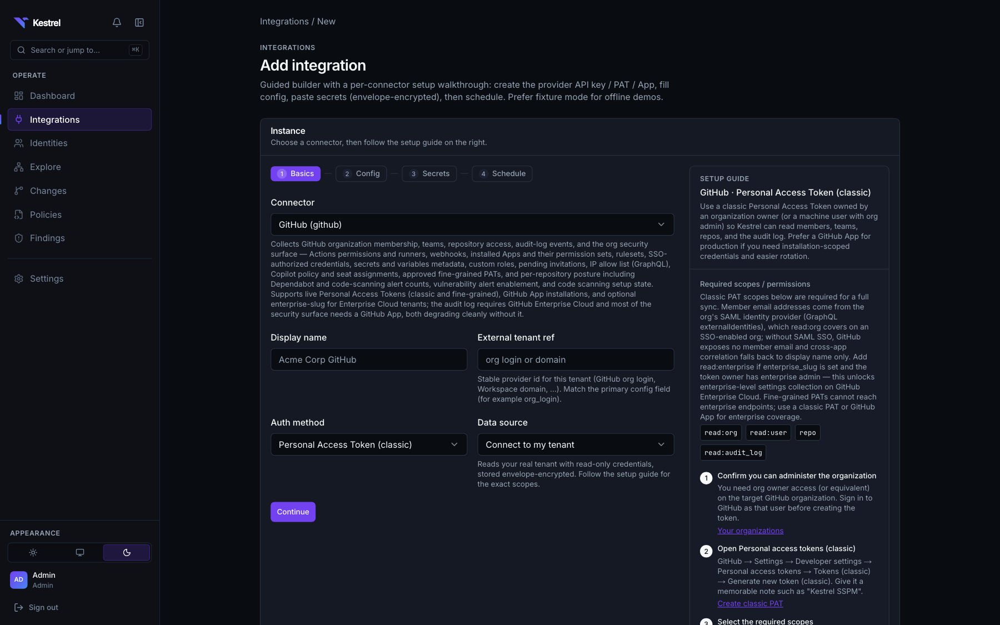

# Connectors

How Kestrel talks to SaaS applications: the SDK contract every connector
implements, the lifecycle the sync pipeline runs, how instances and secrets are
configured, and the state of the first-party connectors. To build one, read
[`connectors/authoring-tutorial.md`](connectors/authoring-tutorial.md) next;
per-application setup guides live under [`connectors/`](connectors/).
Design rationale: [ADR-0005](adr/0005-connector-sdk-interface-design.md).

"Connector" is the developer and SDK term: the Python package that knows how to
read one application. The web UI calls a configured connector instance an
**integration**: one connector, pointed at one tenant, with its own secrets,
sync mode, and schedule. The **Integrations** page lists them, **Add
integration** creates one, and **Integration health** shows their freshness.

## First-party connectors

| Application | Package | Fixture mode | Live mode | Setup guide |
|-------------|---------|--------------|-----------|-------------|
| GitHub | `connectors/github` | Yes | GitHub App (recommended), classic PAT, or fine-grained PAT; membership, the org security surface (Actions, runners, secrets metadata, webhooks, installed Apps, SSO credentials, rulesets, roles, invitations, PAT requests), risk-tiered per-repository posture, and a curated audit-log taxonomy; every gated family degrades visibly | [`github-setup.md`](connectors/github-setup.md) |
| Google Workspace | `connectors/google_workspace` | Yes | Service-account JWT with domain-wide delegation; directory, Policy API, devices, Alert Center, inbound SSO, Admin Reports | [`google-workspace-setup.md`](connectors/google-workspace-setup.md) |
| Okta | `connectors/okta` | Yes | OAuth 2.0 service app (recommended) or SSWS API token; users, groups, roles, apps, factors, password and MFA-enrollment policies, authentication, sign-on, profile-enrollment, and IdP-routing policies with their rules, authenticators, device assurance, network zones, trusted origins, hooks, identity providers, group rules, System Log | [`okta-setup.md`](connectors/okta-setup.md) |
| Slack | `connectors/slack` | Yes | User OAuth token; members, user groups, roles, apps, and with Enterprise Grid the Admin and Audit Logs APIs, Slack Connect | [`slack-setup.md`](connectors/slack-setup.md) |

Each package README states what it collects and, as importantly, what it does
not; the authoritative list of object types is each connector's
`manifest.yaml`. Live collection depth differs per connector, and live-tenant
smoke sign-off is still open for all four first-party connectors (see
[the connector bar](#the-connector-bar)). Fixture mode is the CI and demo path
and never touches the network.

Every connector is read-only toward the application. Write-back remediation is
not implemented.

## Permissions at a glance

What each connector needs to read a tenant. Every credential is read-only
where the provider offers a read-only form; the exceptions are named. The
loader refuses a manifest that declares a known write scope
(`kestrel/connectors/readonly_scopes.py`), but it cannot inspect the
credential you paste, so mint it with only the permissions below. The setup
guides have the click-by-click steps.

| Connector | Auth | Permissions to grant | Plan or edition | Without the optional parts |
|-----------|------|----------------------|-----------------|----------------------------|
| GitHub | GitHub App (recommended), classic PAT, or fine-grained PAT | **App:** read-only Repository → Metadata, Contents, Actions, Environments, Pages, Vulnerability alerts, Code scanning / Dependabot / Secret scanning alerts; Organization → Members, Administration, Webhooks, Secrets, Custom repository roles, Copilot business; audit log read where the plan allows it. **Classic PAT:** `read:org`, `read:user`, `repo`, `read:audit_log` (+ `read:enterprise` with `enterprise_slug`). `repo` is write-capable; GitHub has no read-only scope for private-repository collaborators, so the loader allows it for this connector only. **Fine-grained PAT:** Organization → Members, Administration, Webhooks, Actions (read); Repository → Metadata, Contents (read) | Audit log: Enterprise Cloud. Member 2FA state: token owner must be an org **owner** | Audit-log events are skipped (run marked partial); 2FA becomes unknown, so MFA policies do not fire; most of the org security surface needs the App; fine-grained PATs cannot reach enterprise endpoints. [Setup](connectors/github-setup.md) |
| Okta | OAuth 2.0 service app with a private-key JWT (recommended), or SSWS API token (legacy) | **Service app:** `okta.users.read`, `okta.groups.read`, `okta.apps.read`, `okta.roles.read`, `okta.policies.read`, `okta.authenticators.read`, `okta.logs.read`, `okta.authorizationServers.read`, `okta.orgs.read`, `okta.behaviors.read`, `okta.devices.read`, `okta.logStreams.read`, `okta.brands.read`, `okta.domains.read`, `okta.realms.read`, `okta.apiTokens.read`. **SSWS:** the token inherits its creator's admin role, which is not read-only; Org Admin or Super Admin gives a complete inventory, so use a dedicated service account | Any Okta org; some families only exist where the feature is enabled | Extended families (behaviors, log streams, custom IAM roles, authorization servers, devices) are skipped and recorded; a missing `okta.logs.read` skips event detections but directory sync still works. [Setup](connectors/okta-setup.md) |
| Slack | User OAuth token from an org-installed app (Enterprise Grid), or bot token (single workspace) | **User Token Scopes (Grid):** `users:read`, `users:read.email`, `usergroups:read`, `team:read`, `channels:read`, `groups:read`, `admin.apps:read`, `admin.roles:read`, `admin.teams:read`, `admin.users:read`, `admin.conversations:read`, `auditlogs:read`, `admin.invites:read`, `admin.barriers:read`, `admin.usergroups:read`, `admin.workflows:read`, `admin.analytics:read`, `admin.auth.policy:read`; plus the `team:read` bot scope Slack needs for the install. **Bot token (workspace):** `users:read`, `users:read.email`, `usergroups:read`, `channels:read`, `groups:read`, `team:read` | Admin and Audit Logs APIs: Enterprise Grid, installed by an Org Owner | With a workspace bot token, everything past team, members, user groups, and owner/admin flags (app inventory, org roles, audit logs, SSO policy, barriers, workflows, ...) is skipped and listed on the run. [Setup](connectors/slack-setup.md) |
| Google Workspace | Service-account JWT with domain-wide delegation, impersonating an admin | `admin.directory.user.readonly`, `admin.directory.group.readonly`, `admin.directory.rolemanagement.readonly`, `admin.directory.domain.readonly`, `admin.directory.orgunit.readonly`, `admin.directory.customer.readonly`, `admin.directory.device.mobile.readonly`, `admin.directory.device.chromeos.readonly`, `drive.readonly`, `admin.reports.audit.readonly`, `cloud-identity.policies.readonly`, `cloud-identity.devices.readonly`, `cloud-identity.inboundsso.readonly`, plus three Google offers no read-only form of: `apps.groups.settings`, `admin.directory.user.security` (OAuth tokens per user), and `apps.alerts`. Kestrel only reads through them. The impersonated admin must hold the matching Admin console privileges (Super Admin is simplest) | Any edition with an admin to impersonate; what Alert Center and device management return depends on the edition | Policy API settings, devices, alerts, inbound SSO, and Admin Reports activity are optional and skipped when their scope, API, or privilege is missing; the minimal scope set in the setup guide covers identities, Drive, and Admin Reports. [Setup](connectors/google-workspace-setup.md) |

## Lifecycle

`kestrel.sync.pipeline.run_sync` drives every connector, first-party or
scaffolded, through the same steps:

1. **Configure.** Non-secret JSON on the `ConnectorInstance` (an org login, a domain, a base URL).
2. **Authenticate** (live only). The connector's `auth` builds a `Transport`. Fixture mode injects a `FixtureTransport`. The SSRF guard validates every URL in the config before a live client exists.
3. **Discover.** The collector reports which object types it can actually collect for this tenant. Families gated by plan or permission are skipped and reported, not treated as failures or deletions.
4. **Collect.** The collector yields `RawObject`s per object type. Pagination is connector-specific and must raise (`PaginationLimitError`) rather than silently truncate when a page cap is hit.
5. **Normalize.** A pure, I/O-free `Normalizer` maps each `RawObject` to `NormalizedObject`s and `NormalizedRelationship`s using the provider's own ids. The raw payload travels with the row as `raw_source`.
6. **Upsert, graph, snapshot, classify, evaluate.** Owned by the pipeline, not the connector: entity upsert keyed by `(application_instance_id, provider_object_id)`, `events` for every diff, graph write, hashed snapshot, change classification, policy evaluation, findings reconciliation. See [`architecture.md`](architecture.md#sync-pipeline).

Deletion handling: an object absent from a complete run is tombstoned through
`last_seen`; deletion detection is suppressed on `partial_failure` runs so a
gated family never reads as revoked access.

## The SDK contract

`kestrel.connectors.sdk.base` defines four `typing.Protocol`s, not base classes:

| Protocol | Responsibility |
|----------|----------------|
| `Transport` | `request()` / `paginate()`; `LiveHTTPTransport` (`kestrel.connectors.sdk.transport`: httpx, retry on 429 with injected sleep, same-origin next-URL guard) and `FixtureTransport` (`kestrel.connectors.sdk.fixtures`: exact request-signature replay from JSON files) |
| `Collector` | `discover()`, `collect(object_type, since=)`, optional `health_check()` |
| `Normalizer` | `normalize(raw) -> list[NormalizedObject | NormalizedRelationship]` |
| `Connector` | The entry point the registry discovers: a `manifest`, `configure()`, `authenticate()`, `build_collector(transport)`, `build_normalizer()` |

Authentication has no protocol of its own. `Connector.authenticate()` hands off
to the connector's `auth` module, whose `build_live_transport()` turns the
instance's config and secrets into a `Transport` (live mode);
`kestrel.connectors.sdk.credentials` holds the shared helpers for it. Fixture
mode never calls `authenticate()` and injects a `FixtureTransport` instead.

A connector is a Python package exposing `[project.entry-points."kestrel.connectors"]`
and shipping a `manifest.yaml`:

- `name`, `display_name`, `version` (must match `pyproject.toml`), `description`
- `auth_methods[]` with `id`, `secret_fields`, `config_fields` (plus `optional_config_fields`, the subset the create form may leave blank; every other config field is required), and the in-product setup guide (`setup_overview`, ordered `setup_steps`, `field_help`, `scopes_note`) that Integrations renders while an operator mints credentials
- `setup_docs`: the path of the setup guide under `docs/connectors/`, linked from the UI
- `required_scopes`: validated at load and by `kestrel connector validate`; known write, `ReadWrite`, and `.manage` scopes are rejected. GitHub classic `repo` is allowlisted for private-repository metadata with the tradeoff stated in its setup guide. This constrains *declared* scopes; connector Python itself is trusted code
- `object_types[]` with `maps_to_entity` and optional `supports_incremental`
- `supports_events` and `change_classes[]`: the change-coverage contract (below)
- `example_config`, `fixtures_path`

`kestrel connector validate <path>` checks the manifest, loads the package,
replays the fixtures through collect → normalize, and verifies the coverage
contract. It runs offline and in CI.

## Change-coverage contract

Changes is a snapshot diff (DEC-024), so a connector guarantees coverage by
normalizing into the kinds the upsert already diffs (`identity`, `grant`,
`group_membership`, `oauth_application` / `oauth_scope` / `oauth_grant`,
`setting`) with the classifier signals set (`is_privileged`, sensitive scopes,
setting categories). A connector that declares `change_classes` must ship
`fixtures/changed/` alongside its baseline fixtures; validate replays t0 → t1
and fails if a declared class (for example `admin_granted`) does not appear in
the diff. Graph edges without a `grant` row do not count as coverage. Details:
[`changes.md`](changes.md).

## Instances, secrets, and health

Operators create connector instances from **Integrations → Add integration**, a
manifest-driven wizard (basics → config fields → secrets → schedule), or via
the API:

| Surface | Behavior |
|---------|----------|
| `POST /connector-instances` | Creates the instance; optional `secrets` map; live mode requires every declared secret field; config URLs are SSRF-checked (`400` on a private or link-local address) |
| `GET /connector-instances/{id}` | Config plus secret **status** (`configured` / `missing`), never values |
| `PUT /connector-instances/{id}/secrets` | Envelope-encrypts via `kestrel.secrets.store`; an empty value keeps the existing ciphertext |
| `POST /connector-instances/{id}/test-connection` | Runs the collector's `health_check` (fixtures or live auth) without writing inventory; failures are classified (`auth`, `permission`, `rate_limit`, `network`) so the operator sees "missing scope X", not "unreachable" |
| `POST /connector-instances/{id}/sync` | Enqueues a run; `schedule_cron` runs it on a schedule ([`operations/scheduled-syncs.md`](operations/scheduled-syncs.md)) |
| `GET /connector-instances/{id}/runs` | Run history with status (`success` / `partial_failure` / `failed`), counts, drift labels, and skipped families |

Secrets are stored only in `connector_secrets` (AES-256-GCM envelope encryption,
[ADR-0004](adr/0004-secrets-storage-and-encryption.md)), decrypted only when
authenticating a live run, and redacted from logs and responses by the
manifest's `secret_fields`. Config JSON rejects secret-looking keys (`token`,
`api_token`, `bot_token`, …). Audit events record field names only.

## Incremental sync

Inventory is always a full snapshot (DEC-024): the Changes feed is a diff of
consecutive complete collections. Activity families are different. Audit logs
are append-only history, so an object type that declares
`supports_incremental: true` in the manifest receives `since` from
`run_collection`, taken from the `connector_cursors` table (one watermark per
connector instance and object type). The watermark handed to the collector is
the stored one minus a fifteen-minute overlap, because provider audit logs are
eventually consistent and asking for the exact boundary drops late events; the
re-read costs nothing because audit rows upsert on their provider object id and
never write Changes rows.

An **events-only poll** runs on its own Celery beat entry (every 300 seconds)
for instances that already have a `schedule_cron` and whose connector declares
an incremental object type. Such a run is recorded with
`ConnectorRun.is_incremental = true`: it is a success, but not evidence of a
full inventory, so deletion detection, graph-edge pruning, and snapshot writing
are suppressed, it never becomes the Changes baseline, and it never satisfies
connector freshness on its own. `FixtureTransport.volatile_params` strips the
cursor's timestamp from a signature on a miss, which is what gives the
incremental path offline coverage.

## Deleting a connector instance

`DELETE /api/v1/connector-instances/{id}` (the **Delete connector** button)
removes the instance and everything collected through it: secrets,
`connector_cursors`, run history, change events, graph nodes, edges and
snapshots, the inventory of the bound application instance, and findings whose
subjects belonged to it. The application instance goes too, unless another
connector instance is still bound to it.

There is no option to keep the inventory. Every inventory row carries a NOT
NULL `source_connector_run_id`, and runs cannot outlive their instance, so
inventory without its connector is not representable.
`kestrel/connectors/delete.py` lists every foreign key it clears, and a unit
test checks that list against the schema, so a new table that references a
connector's runs or application instance fails CI until the delete handles it.

## Custom connectors

Internal applications use the same SDK. What exists for them:

- `kestrel connector create <name>` scaffolds a working, fixture-backed package (see [`examples/custom-connector/`](../examples/custom-connector/)).
- `AuthMethod.api_key`, `ResourceType.custom`, `ApplicationType.custom`, and `ConnectorSource.CUSTOM` let a package outside the first-party set persist and show up under Integrations → **Custom**.
- Packs may declare `application: custom` or a specific custom application.
- `KESTREL_CUSTOM_CONNECTORS_DIR` is scanned by `discover_connectors()`, so a package dropped in that directory appears without a Dockerfile change; first-party entry points win on a name collision.
- `KESTREL_CONNECTOR_URL_ALLOWLIST` (hostname-exact, empty by default) lets a live instance reach a loopback or Compose-internal address; link-local and cloud-metadata addresses are rejected even when listed. Compose sets `127.0.0.1,localhost,host.docker.internal`.

[`examples/custom-connector`](../examples/custom-connector/) is the reference
package for this path: Bearer auth, a fixture transport, a normalizer, a pack
policy, and tests. There is no in-app package upload by design (DEC-022):
connectors are trusted Python, so they are installed like any dependency. A
generic HTTP / OpenAPI connector for simple REST APIs is proposed (DEC-022)
but not yet built.

## Live smoke checklist

Use this after connecting a real tenant. Fixtures (`kestrel demo up`) remain
the CI and offline path.

1. **Integrations → Add integration.** Sync mode defaults to **live**.
2. Complete the in-product setup guide (scopes, tokens, app registration).
3. Paste secrets. The wizard runs **Test connection** before the instance is created and shows a per-permission checklist; a wrong token or missing scope must produce a classified message, not "unreachable". Nothing is saved by the test. Continue only when the checks the tenant needs are green, or choose **Save anyway** and test again from the integration's page.
4. **Sync now** and wait for a successful run in the runs list. Skipped families are named in the run detail.
5. **Explore.** Search a known admin; confirm groups, roles, and OAuth hops. For Okta, focus a group that is assigned to an app: members on one side, apps on the other.
6. **Findings.** Enable the application's posture pack and confirm at least one policy evaluated.
7. Optional **Changes.** Flip a privilege or sharing setting in the vendor console, sync again, and confirm a classified row.

Record only non-secret metadata (org login, workspace or tenant id, domain,
org URL host) in your own notes. Never commit tokens, private keys, or
screenshots that show them. Each setup guide has a "Building a test tenant"
section for staging a throwaway environment that exercises the pack.

## The connector bar

"Best in class" is judged against a fixed standard, not per application. A
first-party connector is finished when it satisfies all eight criteria:

1. **Least-privilege read-only auth.** Every declared scope passes
   `assert_read_only_scopes` at registry load. Where a provider forces a
   write-shaped scope for a read (GitHub classic `repo`), the connector offers
   a credential type that does not (GitHub App) and the setup doc recommends it.
2. **Coverage across all six families.** Identity, privilege, app / OAuth,
   sharing / external, settings (tenant **and** subject-scoped), and activity.
   Subject-scoped settings are the criterion most connectors fail: a
   per-repository branch protection rule or a per-workspace Slack setting is
   not a tenant setting.
3. **Degradation is visible, never silent.** Every family that a plan, scope,
   or admin role can gate records `skipped_object_types[object_type]`; the run
   is marked `PARTIAL_FAILURE` and deletion detection, edge pruning, and
   snapshot writing are suppressed. An empty list returned because a token
   lacked a scope is exactly the failure this prevents: it reads as mass
   revocation in Changes. Rate-limit exhaustion is not a skippable gate; it
   fails the run. `kestrel.connectors.sdk.failures` (`is_skippable_gate`,
   `classify_http_failure`) encodes the rule; `classify_github_failure` shows a
   provider whose rate limits also arrive as 403s.
4. **Cursored incremental for activity, snapshot for inventory** (above). A
   type that declares `supports_incremental` must actually receive `since`,
   and its fixture transport must cover the cursored signature.
5. **Declared change classes with t0 to t1 fixtures.** Every privilege, app,
   sharing, and security-setting family declares its `ChangeClass` in
   `manifest.yaml` and ships a `fixtures/changed/` overlay that produces it.
   Graph edges are not coverage; a `grant` row is.
6. **A pack policy per collected posture family.** Collecting a setting nobody
   checks is inventory, not posture.
7. **Four kinds of unit test:** normalizer, collector (dispatch, fan-out,
   memoization, skip recording), client / pagination, and health. Use
   `kestrel.testing.RecordingTransport`; the repo has no HTTP-recording layer
   by design.
8. **Honest docs and a green live smoke.** The setup doc states per-plan and
   per-credential limits in the affirmative, and the connector has a green row
   in the live smoke checklist from a real tenant.

**Fixture provenance.** Every payload field that produces a `setting` must be
declared in `connectors/<name>/fixtures/PROVENANCE.yaml` — the endpoint, a link
to the provider's documentation, and whether the field is something the API
returns (`returns`), something Kestrel's collector injects (`synthetic`), or a
value that depends on no field at all (`constant`).

This exists because four connectors shipped settings built from fields their
providers do not return. The values lived only in fixtures, so every offline
test passed while the check was dead on a live tenant — and two of them raised
high-severity false positives against tenants that were configured correctly.
Reading fixtures did not catch it, four times.

`tests/unit/connectors/test_fixture_provenance.py` derives which fields a
normalizer actually consumes, by removing each one and seeing whether the
emitted settings change, so nobody has to maintain that list by hand. What it
cannot derive is whether the provider really returns a field. That is the claim
the file records, and the reason to check it against the documentation rather
than against the fixture.

Two more contracts back the bar. `maps_to_entity` in a manifest is what
`infer_change_classes` and `kestrel connector validate` read to decide a
connector's coverage contract, so it must name a kind the normalizer actually
emits for that object type (`NORMALIZED_KINDS` in `kestrel.sync.upsert`:
`application_instance` is not one, and `tenant_setting` is the table, not the
kind). And provider audit rows never write Changes rows; they reach operators
through Findings event detections and the actor overlay.

| Criterion | GitHub | Okta | Slack | Google Workspace |
|-----------|--------|------|-------|------------------|
| Read-only auth | done | done (OAuth service-app preferred) | done | done (`apps.alerts` allowlisted) |
| Six-family coverage | done | done | done (Grid) | done (Policy API + devices) |
| Visible degradation | done | done | done | done |
| Cursored incremental | done | done | done (`oldest` cursor) | done |
| Declared change classes | 4+ | 6 | 4+ | 6 |
| Policy per posture family | done | done | done | done |
| Four kinds of unit test | done | done | done | done |
| Honest docs and live smoke | docs done; smoke open | docs done; smoke open | docs done; smoke open | docs done; smoke open |

The open rows are open work; [open an issue](https://github.com/kestrel-security/kestrel/issues) describing the approach before picking one up.

## Reference

- [`connectors/authoring-tutorial.md`](connectors/authoring-tutorial.md): build a connector end to end
- [`examples/custom-connector/`](../examples/custom-connector/): the scaffold output
- [`policies.md`](policies.md): packs that evaluate what connectors collect
- [`threat-model.md`](threat-model.md): SSRF guard, secrets, and the connector trust boundary
