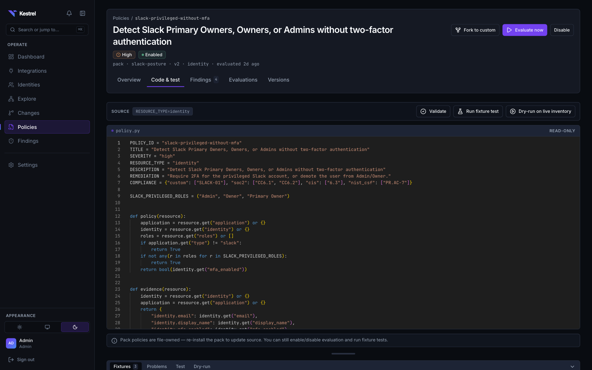
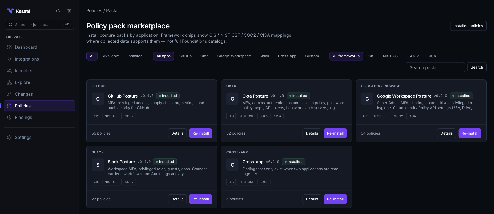

# Policies and packs

A Kestrel policy is a Python module with `policy(resource) -> bool`. Policies
are compiled with RestrictedPython, evaluated in an isolated subprocess by
default, tested against JSON fixtures, versioned, and distributed as packs.
Design rationale: [ADR-0009](adr/0009-python-policies.md). Findings that
policies open are described in [`findings.md`](findings.md).

## The policy contract

Pack and custom policies share one module-level contract:

```python
POLICY_ID = "okta-admin-without-mfa"
TITLE = "Okta administrator without MFA"
SEVERITY = "high"  # low | medium | high | critical
RESOURCE_TYPE = "identity"  # identity | grant | setting | oauth_application | application | event | ...
DESCRIPTION = "..."
REMEDIATION = "..."
COMPLIANCE = {"cis": ["6.5"], "nist_csf": ["PR.AC-7"]}  # optional
REQUIRES = ["github:branch_protection"]  # optional: data capabilities the check needs
PROFILE = "level_1"  # optional: level_1 | level_2 | monitor


def policy(resource) -> bool:
    """True = compliant, False = open a finding."""
    return not (resource["is_privileged"] and not resource["mfa_enabled"])


def evidence(resource) -> dict:
    """Flat fields stored on the finding."""
    return {"email": resource["email"], "roles": resource["roles"]}
```

`kestrel.policies.authoring` validates and compiles the source with
RestrictedPython: no imports, no I/O, a safe set of builtins (`any`, `all`,
`list`, `dict`, `len`, `isinstance`, …), a subset of the `time` module, and
the shared helpers below. Validate also rejects any name the policy reads that
nothing provides (`datetime`, a misspelled helper), since such a name compiles
and only fails on the first row that reaches it. Rows for the declared `RESOURCE_TYPE`
are loaded by `kestrel.policies.dataload`; the nested `application` object on
every row carries the catalog `type` and `name` plus the instance
`display_name`, `external_tenant_ref`, and `status`.

`REQUIRES` names capability keys the policy depends on (connectors declare
`provides_capabilities` in their manifest, for example
`github:branch_protection`). The coverage service joins the two against the
org's connected instances, so a policy whose data is not collected reports as
**not assessable** instead of silently passing; policies without `REQUIRES` are
always assessable. `PROFILE` lets a pack be installed at a benchmark level.

At evaluation time `merge_baseline_evidence` fills missing evidence fields from
the loaded row (identity roles, MFA, flags; setting key and value; grant
permission; application display name) so every finding has remediator context
even when `evidence()` is minimal. Policy-provided keys always win.

### Shared helpers

Policies cannot import, so the runtime injects these into every policy's
globals ([`kestrel/policies/runtime/helpers.py`](../kestrel/src/kestrel/policies/runtime/helpers.py)).
They are available in both runtimes, in `kestrel policy test`, and in dry run.
Use them instead of pasting a local copy.

| Helper | Returns |
|--------|---------|
| `now()` | The current time as a UTC `datetime`, fixed for the whole evaluation run |
| `parse_timestamp(value)` | A UTC `datetime` from a `datetime`, `date`, epoch number, or ISO 8601 string; `None` if missing |
| `days_since(value)` | Days elapsed since the timestamp (negative if in the future); `None` if missing |
| `within_last_days(value, days)` | `True` if the timestamp is at most `days` days ago; `False` if missing |
| `duration_seconds(value)` | Seconds in an ISO 8601 (`P30D`, `PT90M`) or protobuf (`"86400s"`) duration; `None` if missing |
| `get_path(value, path, default=None)` | `value["a"]["b"]` for `path="a.b"`; `default` when a step is missing, `None`, or not a dict |
| `has_admin_grant(resource)` | `True` if any grant in `resource["_related"]["grants"]` (identity rows) has `permission_level == "admin"` |
| `application_matches(resource, types, name_contains=None)` | `True` if `application.type` is in `types`, or its name contains `name_contains` (case-insensitive) |
| `email_domain(value)` | The lowercased domain of an email address; `None` if missing |
| `domain_matches(value, domains)` | `True` if the email or host is in one of `domains` or a subdomain of it; `False` if missing |
| `ip_in_networks(value, networks)` | `True` if the IP address is inside one of the CIDR `networks`; `False` if missing |
| `matches_any(value, patterns)` | `True` if the string matches one of the shell-style globs (case-insensitive); `False` if missing |
| `PolicyDataError` | The exception the helpers raise on malformed data; raise it yourself for the same reason |

Every helper that takes row data raises `PolicyDataError` on a value it cannot
read (an unparseable timestamp, an address with no `@`, a duration in months).

`now()`, `days_since`, `within_last_days`, and the sandbox's `time.time()` all
read one clock, pinned when an evaluation pass starts, so every row in the pass
is judged against the same instant. The sandbox's `time` has the clock and
formatting functions (`time`, `gmtime`, `strftime`, …) but not `sleep`,
`tzset`, or the process clocks. Prefer `now()` and the helpers over raw `time`.

`packs/ruff.toml` declares these names as builtins so pack policies lint
cleanly; a unit test keeps that list in step with what the runtime injects.

### Missing and malformed data

`policy()` returns `True` for compliant, so any code path that guesses
`True` when it cannot read the data hides a finding. Kestrel's rule, which
the helpers follow and pack policies must too:

- **Missing** (`None`, empty string): a fact about the row. The helpers say
  so (`None`, or `False` for "not shown to be recent"), and the policy decides
  what absence means. `return within_last_days(last_active, 90)` reports an
  admin with no recorded activity; a check whose source does not always
  populate a field can choose to pass on `None`, and should say why in a
  comment.
- **Malformed** (a timestamp or duration in a format nothing recognizes): the
  policy cannot know the answer, so it raises `PolicyDataError` instead of
  answering. Do not wrap it in `except Exception` (ruff's `BLE` rule rejects
  that in packs).

A raised error fails that policy's evaluation: the `PolicyEvaluation` row is
recorded with `status = error` and an `error_message` naming the policy, the
subject, and the value (visible on the policy's Evaluations tab and in
connector-run detail), and no findings are opened or auto-resolved for that
policy in that run. Existing findings stay open. One bad row therefore pauses
the policy rather than being silently counted as compliant: a visible error is
preferable to a missed finding in a security tool. In `kestrel policy test`
the error fails the fixture test.

### Resource types worth knowing

- `identity` rows carry `oauth_grants`: the OAuth authorizations that account consented to, each with the application name, publisher, verification state, sensitive scopes, and `last_used_at`. Always a list, empty when there are none. A consented token does not go through the sign-in path, so disabling an account does not revoke it — this is what lets a policy compare the two.
- `identity` rows carry `privileged_application_types`: for a privileged identity, the distinct application types where identities sharing the same email (or provider id when email is missing) also hold privileged roles. The cross-app concentration policy uses it.
- `application` evaluates over connected **ApplicationInstance** rows (one per tenant), not catalog entries; matches open findings with `subject_type=application`.
- `resource` evaluates over `Resource` rows (repositories, shared channels, drives, and other provider objects) via `load_resource_rows`. Each row carries the **subject-scoped settings that govern that one resource**, both as a `settings` list and as `settings_by_key` for direct lookup, so a GitHub policy reads `resource["settings_by_key"]["repo_default_branch_protected"]["value"]` rather than provider-shaped `raw_source`. Both are empty when the connector collects no per-resource settings, so index defensively. Matches open findings with `subject_type=resource`.
- Subject-scoped settings are `tenant_settings` rows with `subject_type` / `subject_id` set: a branch protection rule belongs to a repository, not to the org with the repo name buried in its key. Connectors declare `subject_type` (a normalized kind) plus `subject_ref` (the subject's provider id) on the normalized setting and emit an `applies_to` relationship alongside it; the upsert resolves the ref through the run's id map regardless of emission order, and a setting whose subject is absent stays tenant-wide. `RESOURCE_TYPE = "tenant_setting"` still loads every setting, scoped or not.
- `event` evaluates over `ActivityEvent` rows from synced audit logs (GitHub audit log, Okta System Log, Slack Audit Logs). Each row includes `attributes`, the provider detail the normalizer preserved (branch name, added scope, target repository), always a dict. Only events with `occurred_at` inside `KESTREL_POLICY_EVENT_LOOKBACK_DAYS` (default 90, aligned with activity retention) are loaded, so large histories stay bounded. Event findings reach SIEMs through the same outbound webhooks as posture findings.

## Runtime

| Mode | `KESTREL_POLICY_RUNTIME` | Behavior |
|------|--------------------------|----------|
| subprocess (default) | `subprocess` | Compile and validate in-process; evaluate rows in `python -m kestrel.policies.runtime.worker` |
| restricted | `restricted` | RestrictedPython entirely in-process, with no time or memory limit; for the test harness and local fixture loops only |

`KESTREL_PACK_POLICY_RUNTIME` (unset by default, so it follows the setting above)
selects the runtime for first-party pack and system policies alone; `kestrel demo`
sets it to `restricted` for speed. Custom policies always use
`KESTREL_POLICY_RUNTIME`, so trusting packs never runs operator- or
AI-authored code without limits. Every pack-sourced policy counts as trusted,
including a pack installed from a local path, so leave it unset if you install
packs you have not reviewed.

`KESTREL_POLICY_EVAL_TIMEOUT_SECONDS` (default 30) caps each batch's wall time,
and the worker also caps its own CPU time just past it. `KESTREL_POLICY_EVAL_MEMORY_MB`
(default 512, `0` disables) caps what a worker may allocate beyond the
interpreter's own footprint, via `RLIMIT_AS` (enforced on Linux; macOS ignores
it, so the timeout is the only limit there). Rows are split into batches of
`KESTREL_POLICY_EVAL_BATCH_SIZE` (default 2000) and results are merged with no
silent drops. The worker child starts with an allowlisted environment (`PATH`,
locale, and interpreter variables only): `KESTREL_MASTER_KEY`, `DATABASE_URL`,
`REDIS_URL`, and every other `KESTREL_*` setting stay in the parent, so policy
code that escaped RestrictedPython would still not hold the key that decrypts
stored secrets. Fixture tests (`kestrel policy test`, the workbench, AI drafts)
and capturing fixtures from matches run `policy()` through the same runtime,
never directly in the API process.

Compiling a policy executes its module body in the calling process, so the
module body may only *declare*: literal constants (numbers, strings,
containers, arithmetic on numbers, `frozenset({...})`) and undecorated
functions with literal defaults. A loop, call, comprehension, class, or
something like `"a" * 10**9` at module level is a validation error; put the
logic inside `policy()`. Subprocess isolation is a
security control for untrusted policy code; it is not a full sandbox
([`threat-model.md`](threat-model.md)).

Evaluation is deterministic: the same database snapshot and the same policy
version produce the same matches. Scheduled evaluation never calls an LLM.

## Evaluation and findings

1. Compile and validate the source.
2. Load candidate rows for `RESOURCE_TYPE`.
3. Run `policy()` and `evidence()` in the configured runtime.
4. The findings pipeline reconciles matches per policy and subject, across versions: new match → open finding; open finding no longer matching → auto-resolved; muted, suppressed and excepted findings keep their status; outbound webhooks fire on open and resolve. Details: [findings lifecycle](findings.md#reconciliation).

Evaluation runs after every successful sync and on demand:

| Surface | Purpose |
|---------|---------|
| `POST /policies/{id}/evaluate` (Analyst+) | Evaluate now and reconcile findings without waiting for a sync |
| `GET /policies/{id}/evaluations` | Evaluation log: status, match count, errors, connector-run link; the Evaluations tab on policy detail |
| `GET /policies/{id}/findings` | Open findings for the policy with a severity rollup and `ever_evaluated` |
| `GET /policies` | Inventory enriched with `resource_type`, `open_finding_count`, `last_evaluation_status`, `last_evaluated_at` |

## Authoring, testing, and versions



```bash
uv run kestrel policy validate path/to/policy.py
uv run kestrel policy test path/to/policy.py --fixtures path/to/policy.fixtures.json
uv run kestrel policy contract            # helpers, rules, idioms, row shapes (--format json)
```

Fixtures are JSON rows for the resource type plus `expected_match_subject_ids`.
Pack fixtures are file-owned under `packs/*/policies/fixtures/`; custom
policies persist fixtures on the policy row (`Policy.fixtures`).

The Policies workbench (`/policies/new`, `/policies/{id}`) uses a Monaco
editor with validate-error gutter markers, source and fixtures side by side, a
`RESOURCE_TYPE` chip parsed from the source, **Validate**, **Fixture test**,
**Dry run** against live rows, **Save fixtures**, and **Save matching
subjects as fixture** after a dry run. API equivalents:
`POST /policies/validate`, `POST /policies/{id}/test`,
`POST /policies/test-draft`, `POST /policies/dry-run-draft`,
`GET`/`PUT /policies/{id}/fixtures`, `POST /policies/{id}/fixtures/from-matches`.

Custom policies are versioned: every edit creates an immutable
`PolicyVersion`; `GET /policies/{id}/versions` lists them and
`POST /policies/{id}/versions/{version_id}/activate` (Analyst+) rolls back
without rewriting history. Pack policies stay file-owned: reinstall the pack or
fork the policy (`POST /policies/{id}/fork`, disabled by default) to edit it.

## AI-assisted drafts

`POST /policies/generate` (Analyst+) takes `{ intent, resource_type?,
connector_hint?, include_fixtures? }` and returns `{ source_text, provider,
model, validation, fixtures?, fixture_test?, probe_test? }`. Credentials resolve in order:

1. Org **Settings → AI** (`org_llm_settings`): OpenAI or Anthropic; the key is envelope-encrypted and never returned after save (`GET`/`PUT`/`DELETE /settings/ai`).
2. `KESTREL_LLM_API_KEY` with optional `KESTREL_LLM_PROVIDER`, `KESTREL_LLM_BASE_URL`, `KESTREL_LLM_MODEL`.
3. Deterministic intent templates for high-confidence intents (Okta administrators without MFA, MFA enrollment not required, disabled or dormant admins, weak password policy, bookmark/SWA apps, unused API tokens, Threat Insight disabled). Novel intents without a provider return `provider=unconfigured` and empty source, never a silent `return True` stub.

Prompts are built from the policy authoring contract
([`kestrel/policies/authoring_contract.py`](../kestrel/src/kestrel/policies/authoring_contract.py)):
every helper with its signature and docstring, the sandbox builtins, the
authoring rules, and idioms taken from shipped pack policies. They also
include the dataload schema for the resource type, up to two reviewed pack
policies for the selected connector, and, when a connector or connected
application is selected, its field catalog and redacted live samples
(`GET /policies/generate/catalog`).

Each model draft then goes through three checks, and one repair turn sees
every failure:

- **Validate**: compile errors and names nothing defines.
- **Edge-case rows** (`probe_test`): `policy()` and `evidence()` run over the
  fixture rows again with each timestamp missing, an ISO string, naive, and
  timezone-aware; with another application; and with optional fields left out.
  Only crashes count. This catches code a fixture never reaches.
- **Fixture test**: fixtures are chosen for the intent when Kestrel has a set
  whose expected matches fit it (for example Okta external users who are stale
  or never signed in). Otherwise the generic connector scaffold is used and
  its result is marked `advisory`: it is shown, but it never steers the repair
  turn, because its expected matches were written for another intent.

Provider errors surface as operator-facing messages (a 429 says the provider
is rate-limiting, not a raw URL).

Outside agents (Claude Code, Cursor, MCP clients) should read the same
contract: see [Writing policies with an AI agent](policies-for-agents.md).

Drafts are never auto-enabled. The human gate is validate → fixture test →
dry run → create and enable a version. Generation is separate from runtime
evaluation; only reviewed source ever enters the runtime.

## Packs

A pack is a directory with `pack.yaml`, `policies/*.py`, `policies/fixtures/`,
and `compliance_controls.yaml`. `pack.yaml` carries `name`, `version`,
`display_name`, `summary`, `description`, `application`, optional
`categories[]`, `frameworks[]`, `vendor_baselines[]`, and `policies[]` (the
slugs the pack ships; a unit test checks it against the policy files). Packs
are discovered from `KESTREL_PACKS_DIR` (default `./packs`). A pack owns the
fixtures for its own policies; fixtures are never resolved from another pack.

| Pack | Application | Policies | Contents |
|------|-------------|----------|----------|
| `github-posture` | GitHub | 59 | Org 2FA and settings; supply chain (default `GITHUB_TOKEN` scope, workflows approving their own pull requests, third-party Actions, runner groups reachable from public repositories, org secret visibility); org exposure (webhooks without TLS verification, org and repository rulesets that evaluate without enforcing, over-permissioned installed Apps, stale SSO credentials, pending admin invitations, pending fine-grained PAT requests covering every repository, private repositories that may be forked out of the org); per-repository posture (default-branch protection, required reviews, admin bypass, force-push, writable deploy keys, environments without reviewers, secret scanning and push protection, Dependabot, open secret-scanning alert counts); privileged access; audit-log policies (privilege change, branch-protection removal, repositories made public, SSO changes, App installs, webhooks, deploy keys); mapped to CIS GitHub Benchmark v1.2.0 where collection supports it |
| `okta-posture` | Okta | 32 | MFA enrollment and phishing-resistant authenticators, authentication-policy rules without MFA, session lifetime (excessive or unlimited), self-service registration, network zones matching everything, plaintext hook endpoints and trusted origins, IdPs that auto-provision users, admins (disabled, dormant), password policy, app sign-on (bookmark/SWA), unused API tokens, Threat Insight, System Log activity; mapped to the DISA Okta IDaaS STIG |
| `gws-posture` | Google Workspace | 34 | Super Admin MFA and per-account 2-Step Verification enforcement, external sharing, shared drives, privileged role hygiene, group exposure (external members, membership open to anyone with a Google account, mail accepted from outside the organization), third-party OAuth scopes, admin-audit and login activity (2-Step Verification turned off, suspicious sign-ins); mapped to CISA SCuBA where collection supports it |
| `slack-posture` | Slack | 27 | Workspace 2FA and SSO enforcement, session duration, privileged roles without MFA, dormant admins, guests, app approval, over-scoped and unused apps, Slack Connect, Audit Logs activity (privilege grants, app installs and scope expansions, guest creation, external sharing); mapped to NIST CSF 1.1 / CIS Controls v8.1 (there is no CIS Slack benchmark) |
| `cross-app` | Cross-application | 5 | Privileged access concentrated on one identity across multiple applications; an account the identity provider disabled that is still live elsewhere; a company account no identity provider knows about; OAuth grants that outlived the account that authorized them; a guest in one application who administers another. No published baseline enumerates these — they are the checks a per-application scanner cannot compute |

Control-by-control matrices (baseline control, profile level, required data,
collection status, implementing `POLICY_ID`) live under
[`posture-baselines/`](posture-baselines/README.md). Vendor baselines are only
claimed where they exist: CISA SCuBA covers Google Workspace,
not GitHub, Okta, or Slack, and internal control ids use the `custom` framework.

The five packs ship 157 policies, and `kestrel demo up` installs all of them.
Every pack policy is covered by one parametrized test that compiles it and runs its
fixtures ([`testing.md`](testing.md)), so adding a policy adds coverage.

```bash
uv run kestrel pack validate packs/okta-posture
uv run kestrel pack install packs/okta-posture
```

API: `GET /packs` (catalog with the manifest metadata and install state),
`GET /packs/{name}`, `GET /packs/{name}/coverage` (each policy monitored or
not assessable, with the missing capability named), `GET /packs/{name}/install-preview`
(added / updated / unchanged / unassessable by slug), `POST /packs/{name}/install`
(optional `profile`), `POST /packs/{name}/enable` and `/disable` (bulk-flip the
installed policies). Installing creates or updates org policies; `POLICY_ID`
and slugs are stable so findings do not churn across reinstalls.

### Deleting a policy

Disabling is reversible and keeps history: the policy stops running and its
open findings resolve with reason `policy_disabled`. `DELETE /policies/{id}`
(Analyst or higher, also on the policy page and the list's row menu) is the
irreversible path. Findings reference policy versions and evaluations, so the
delete takes the versions, evaluation history, findings and their notes,
evidence, watchers, tickets and exceptions, the policy's org-wide exceptions,
and its control mappings with it. Webhook deliveries are kept as a record of
what was sent. The audit log records `policy.deleted` with the counts.

System policies cannot be deleted (409); disable them instead. A pack policy
can be, but installing its pack again upserts by slug and restores the policy
without its findings; the confirmation says so.

### Marketplace and frameworks



`/policies` is the installed inventory (filters: application, status, source,
open findings, framework). `/policies/packs` is the marketplace: one tile per
pack, filtered by application, framework, install status, and search;
`/policies/packs/{name}` shows baselines, policies by category, the coverage
panel with enable/disable, and the profile-scoped install preview. Tiles use letter marks, not vendor logos.

`COMPLIANCE` mappings (CIS Controls, NIST CSF, SOC 2, CISA SCuBA-style) are
browsable as chips and filters. They are tags on individual policies, not a
complete CIS Foundations catalog for any application; the docs do not claim
otherwise.

## Exceptions, mutes, and evidence

- An `Exception_` ties an accepted risk to a finding and moves it to `exception` status; policy-scoped exceptions can be declared in GitOps manifests.
- Mute/snooze is time-bounded on the finding itself and distinct from an exception.
- Evidence dict keys become `FindingEvidence` rows; severity and remediation text come from the policy version and are surfaced on every finding.

## Distribution

Author, fixture-test, and install packs locally, or declare them in a GitOps
manifest ([`gitops.md`](gitops.md)). Signed or private pack distribution and
a third-party pack registry are not implemented.
